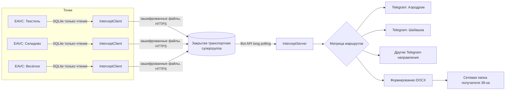

# Архитектура

## Общая схема



## Почему чистая архитектура здесь полезна

Правила маршрутизации и жизненный цикл события не должны зависеть от Telegram, SQLite, Word, Windows или веб-интерфейса. Зависимости направлены к центру:

```text
cmd/                      сборка и запуск программ
internal/interfaces/      HTTP API и понятный локальный интерфейс
internal/infrastructure/  Telegram, EAVC SQLite, состояние, DOCX, файловая доставка
internal/application/     сценарии клиента и сервера, порты репозиториев и шлюзов
internal/domain/          событие, маршрут, направление, ошибки и инварианты
```

Доменный и прикладной слои не импортируют инфраструктуру. Telegram можно заменить другим транспортом, а Word-папку — другим получателем без переписывания правил.

## Два независимых контура

### Контур доставки до сервера

Состояния клиента:

```text
обнаружено → проверен срок 30 минут → сохранено в очереди → загружено в Telegram → подтверждено сервером
                                                     ↘ повтор с задержкой при ошибке
```

Успешный ответ `sendDocument` означает только загрузку в Telegram. Он не считается обработкой сервером. Окончательное состояние клиент устанавливает только после подтверждения с тем же `event_id`.

Ровно 30 минут ещё считается допустимой границей. После неё клиент прекращает попытки и показывает событие как просроченное. Сервер повторно проверяет этот срок при приёме. Своевременно принятому событию сервер даёт отдельные 10 минут на Telegram- и Word-доставки; после этого незавершённые задания становятся просроченными.

### Контур отправки получателям

Состояния сервера ведутся отдельно для пары `event_id + destination_id`:

```text
ожидает → выполняется → доставлено
                 ↘ ошибка → ожидает повтор
```

Это исключает повтор в «Аэродром», если временно недоступна только сетевая папка Word-направления.

Очередь клиента не выпускает более позднее событие того же подразделения, пока предыдущее не подтверждено или не просрочено. Другие подразделения этой точки продолжают работу. На сервере порядок поддерживается отдельно для каждого потока: Telegram-направление вместе с ID темы либо отдельное Word-направление. Поэтому сбой одного топика не останавливает другие топики, но сообщения внутри одного топика не меняются местами.

Текст EAVC делится на блоки по строкам времени вида `12.34`. Клиент добавляет к каждому блоку позывные из `intercept_callsigns`. Сервер хранит ID опубликованных сообщений: новый блок создаёт сообщение, изменённый редактирует существующее, а удалённый удаляет. Состояние сохраняется на диске и переживает перезапуск.

## Протокол события

UUID v7 создаётся клиентом при первом сохранении события в локальную очередь. Он сортируется по времени, остаётся неизменным при повторах и является ключом идемпотентности всей системы.

Внешний конверт содержит минимум открытых данных: версию протокола, `client_id`, `event_id`, `key_id`, время, nonce и шифротекст. Содержимое EAVC шифруется AES-256-GCM. Дополнительными аутентифицированными данными являются версия, клиент, событие и ключ.

Сервер принимает пакет только если одновременно выполнены условия:

- формат и размер допустимы;
- точка активна;
- ID/username Telegram-бота совпадает с зарегистрированным;
- ключ `key_id` действителен;
- AEAD-проверка успешна;
- тема и транспортная группа совпадают с настройкой точки;
- UUID события ещё не обработан либо содержимое полностью совпадает с ранее принятым.

## Конфигурация точки

Администратор создаёт точку в интерфейсе сервера и указывает токен бота точки, ID темы и часовой пояс EAVC. Сервер не знает пути на удалённом компьютере: JSON содержит режим `auto`. Клиент ищет `main.sqlite` рядом со своей папкой, а выбранный локальный путь хранит отдельно и не теряет при обновлении JSON. Сервер проверяет бота и тему, генерирует `client_id`, ключ шифрования и готовый JSON, затем подписывает весь файл ключом Ed25519. Защищённая копия JSON остаётся на сервере и доступна для повторного скачивания из строки точки.

Оператор делает только следующее:

1. распаковывает папку;
2. запускает `InterceptClient.exe`;
3. нажимает «Загрузить настройки» и выбирает полученный JSON.

После импорта клиент проверяет подпись, привязывается к ключу выдавшего файл сервера и защищает секреты средствами Windows для текущей учётной записи. Повторная конфигурация принимается только от того же сервера. Сам исходный JSON следует удалить с компьютера точки после успешного импорта.

Ссылка-приглашение транспортной группы хранится в сервере как памятка администратора. Программа работает по числовому `chat_id`; одна ссылка не даёт Bot API возможности отправлять файлы и не заменяет добавление ботов в группу.

## Изменение маршрутов

Маршруты публикуются версиями. Изменения в таблице интерфейса не действуют до нажатия кнопки публикации. Сервер проверяет всю матрицу и атомарно делает новую версию активной. История содержит автора и время; восстановление старой матрицы создаёт новую версию и не удаляет аудит. Новое направление по умолчанию не имеет включённых ячеек.

## Отказоустойчивость

- Клиент сначала сохраняет событие на диск, затем обращается к сети.
- Сервер сначала сохраняет входной пакет и задания доставки, затем отвечает подтверждением.
- Одна сетевая попытка ограничена 20 секундами, а неудачные доставки получают экспоненциальную задержку перед следующим повтором.
- Независимые серверные потоки обрабатываются параллельно с ограничением числа одновременных попыток.
- После перезапуска очереди продолжаются с диска.
- Повторы безопасны благодаря UUID v7 и уникальным ограничениям хранилища.
- Повреждённый или неподдерживаемый пакет помещается в карантин и не теряется молча.
