# Полная установка и настройка EAVC Connect

> Статус документа: инструкция собрана по фактически выполненной чистой
> установке и проверенным снимкам интерфейсов. Последняя подтверждённая в этом
> прогоне сборка — `0.2.0-rc59` (`build_profile: laboratory`). Это лабораторная
> сборка; её нельзя обозначать как окончательный промышленный релиз.

## Для кого предназначена инструкция

Инструкция рассчитана на администратора, который впервые видит комплект и не
знает внутреннего устройства EAVC Connect. Она начинается с полученного ZIP и
заканчивается проверенной доставкой перехвата из EAVC в Telegram и Word.

В каждом этапе фиксируются:

1. что должен сделать администратор;
2. зачем это требуется;
3. какой результат считается правильным;
4. какие данные нельзя публиковать;
5. что делать при отклонении;
6. какой снимок экрана подтверждает выполнение.

## Имена тестовой установки

Чистая установка выполняется в отдельном тестовом контуре и не затрагивает
существующие рабочие группы.

- аккаунт администратора: `Ан-22-Антей-Тест`;
- Telegram-группы получателей: `Аэродром-Тест` и `Шабашка-Тест`;
- отображаемое имя центрального Telegram-бота: `Ту-96-Тест`;
- названия тем: без суффикса `Тест`, точно как в реальной эксплуатации;
- существующие объекты `Ан-22-Антей`, `Аэродром`, `Шабашка` и `Ту-160` не
  изменяются.

При промышленной установке суффикс `-Тест` не используется:

```text
Ан-22-Антей-Тест  -> Ан-22-Антей
Аэродром-Тест     -> Аэродром
Шабашка-Тест      -> Шабашка
Ту-96-Тест        -> Ту-96
```

## Как работает система

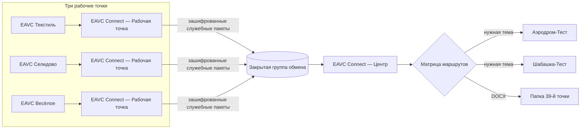

Рабочая точка читает базу EAVC только на чтение. Перед отправкой содержимое
перехвата шифруется. Закрытая группа обмена используется как транспорт, но не
как рабочий получатель. Центр проверяет пакет, применяет опубликованную матрицу
маршрутов и независимо доставляет результат в Telegram и Word.

## Правила безопасности снимков

- токены ботов, ключи, пароли и содержимое файлов конфигурации не должны быть
  видны на снимках;
- если Telegram показывает токен после создания бота, токен закрывается перед
  включением снимка в инструкцию;
- допускается показывать названия, Telegram ID групп и тем, пути установки и
  контрольные суммы архивов;
- каждый снимок должен показывать только один проверяемый шаг.

# Этап 1. Получение и проверка серверного архива

## 1.1. Какой файл нужен

Для первой установки Центра используется:

```text
EAVC-Connect-Center-portable.zip
```

Не путайте его с файлами:

- `EAVC-Connect-Center-update.zip` — пакет обновления уже установленного Центра;
- `EAVC-Connect-Station-portable.zip` — универсальный исходный комплект рабочей
  точки; индивидуальные клиенты позже скачиваются только из настроенного Центра;
- `EAVC-Connect-Station-update.zip` — пакет обновления рабочей точки.

Для проверяемой сборки `0.2.0-rc58` подтверждены:

```text
Размер: 16 933 174 байта
SHA-256: B9AF6194CD80482F92DF050A1C805A5AF939637A8A870640728469AAC0919F1C
```

Совпадение SHA-256 означает, что архив побайтно соответствует файлу,
перечисленному в `release-manifest.json`. Оно не заменяет проверку происхождения
самого манифеста и цифровой подписи релиза.

## 1.2. Куда поместить архив

На компьютере Центра поместите архив на Рабочий стол текущего пользователя.
Не запускайте EXE прямо из ZIP и не распаковывайте комплект в `Program Files`:
Центр должен сохранять настройки, очереди и журналы рядом с программой без
запроса административных прав.

Правильное состояние до распаковки:

- на Рабочем столе находится один файл
  `EAVC-Connect-Center-portable.zip`;
- старой папки `EAVC Connect Center` нет;
- расширения файлов отображаются в Проводнике;
- размер архива соответствует выданному релизу.

### Доказательство 1

Нужен снимок Проводника на компьютере Центра до распаковки. На нём должны быть
видны адрес папки, полное имя ZIP, тип файла и размер. Личные файлы и другие
несвязанные элементы в кадр не включаются.

<!-- SCREENSHOT-01: серверный ZIP на Рабочем столе до распаковки -->

## 1.3. Что находится внутри

После проверки в архиве должны находиться:

```text
EAVC Connect Center/
├── EAVC Connect Center.exe
├── EAVC Connect Updater.exe
├── ПРОЧИТАТЬ ПЕРЕД ЗАПУСКОМ.txt
├── word_template.docx
├── data/
├── logs/
└── station-template/
    ├── EAVC Connect Station.exe
    ├── EAVC Connect Updater.exe
    ├── manifest.json
    └── manifest.sig
```

Папки `data` и `logs`, файл `word_template.docx` и каталог
`station-template` удалять нельзя. Без шаблона рабочей точки Центр не сможет
сформировать готовый индивидуальный комплект клиента.

### Как отличить архив от распакованной папки

На полученном контрольном снимке Проводник показывает розовую вкладку
**Извлечение**, адрес `EAVC-Connect-Center-portable > EAVC Connect Center` и
колонку **Сжатый размер**. Это означает, что администратор только просматривает
ZIP. Файлы ещё не установлены, даже если внутри виден EXE.

<!-- SCREENSHOT-02: содержимое ZIP; источник C:/Users/adm/Pictures/Снимок.PNG -->

Правильный состав подтверждён: две программы, папки `data`, `logs`,
`station-template`, Word-шаблон и памятка присутствуют. Дата `30.12.1899` у
файлов в архиве не означает повреждение: воспроизводимая сборка намеренно
нормализует временные метки, чтобы одинаковый исходный код создавал побайтно
одинаковые архивы.

## 1.4. Правильная распаковка

1. Не запускайте `EAVC Connect Center.exe` из окна с розовой вкладкой
   **Извлечение**.
2. Нажмите **Извлечение → Извлечь всё**.
3. В окне выбора папки укажите непосредственно **Рабочий стол** текущего
   пользователя, а не автоматически предложенную вложенную папку
   `EAVC-Connect-Center-portable`.
4. Оставьте включённым открытие извлечённых файлов и нажмите **Извлечь**.
5. Откройте появившуюся папку `EAVC Connect Center`.

После правильной распаковки путь заканчивается на:

```text
Рабочий стол\EAVC Connect Center
```

Признаки правильного результата:

- розовой вкладки **Извлечение** больше нет;
- колонки **Сжатый размер** и **Сжатие** отсутствуют;
- у `EAVC Connect Center.exe` отображается обычный тип **Приложение**;
- рядом находятся папки `data`, `logs`, `station-template` и файл
  `word_template.docx`;
- нет лишнего уровня
  `EAVC-Connect-Center-portable\EAVC Connect Center`.

### Доказательство 2

Нужен снимок открытой распакованной папки. В адресной строке должен быть виден
Рабочий стол и папка `EAVC Connect Center`, а в таблице — все семь элементов.
Центр до этого снимка не запускается.

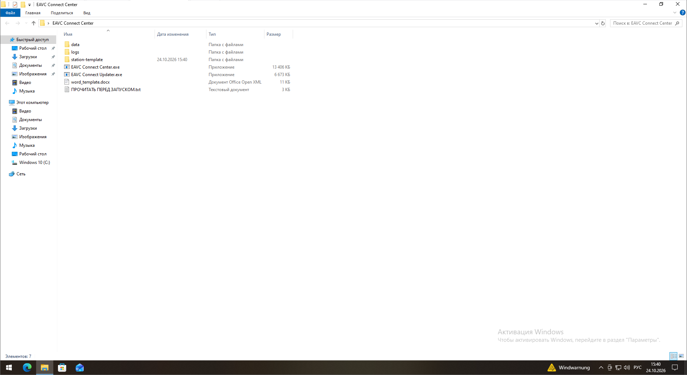

На контрольном снимке видны все семь элементов. Розовой вкладки работы со
сжатыми папками и колонок сжатия нет — это обычная папка, из которой Центр может
сохранять данные и журналы.

# Этап 2. Первый запуск Центра

## 2.1. Что произойдёт при первом запуске

Дважды нажмите `EAVC Connect Center.exe`. Не запускайте программу обновления:
`EAVC Connect Updater.exe` используется только для установки подписанного
пакета обновления в уже работающую систему.

При штатном запуске Центр должен:

1. создать локальные служебные файлы в папке `data`;
2. включить автозапуск для текущего пользователя;
3. запустить локальный защищённый веб-интерфейс;
4. открыть его в браузере по адресу на `127.0.0.1`;
5. показать страницу **Обзор** без заранее созданных получателей, точек и
   маршрутов.

`127.0.0.1` означает этот же компьютер. Это не внешний сайт и не адрес другой
рабочей точки. Интерфейс намеренно недоступен напрямую из сети.

## 2.2. Возможное предупреждение Windows

В манифесте проверяемой сборки `0.2.0-rc58` указано
`center_authenticode: false`: EXE пока не имеет подписи доверенного издателя
Windows. Поэтому на части компьютеров может появиться предупреждение системы.
Не подтверждайте неизвестное предупреждение автоматически — сначала сохраните
его снимок и сверьте имя запускаемого файла и контрольную сумму комплекта.

Если вместо интерфейса появилось системное окно, ошибка или пустой браузер,
ничего дополнительно не нажимайте до фиксации снимка.

### Доказательство 3

После двойного нажатия нужен снимок первого фактически появившегося окна:

- страницы **Обзор**, если запуск прошёл штатно; либо
- предупреждения или ошибки целиком, если Windows остановила запуск.


Контрольный снимок подтверждает штатный первый запуск:

- адрес `127.0.0.1:17632` показывает, что открыт локальный интерфейс этого
  Центра, а не внешний сайт;
- состояние **Настройте связь** ожидаемо до ввода Telegram-параметров;
- индикатор **0 из 5** означает, что ещё не выполнен ни один обязательный этап;
- счётчики рабочих точек, очередей и доставок равны нулю;
- в левом нижнем углу указана версия `0.2.0-rc58` и состояние **Не настроено**;
- кнопки запуска сервиса недоступны до завершения обязательной конфигурации.

Пустые счётчики на этом этапе не являются ошибкой. Нельзя нажимать **Старт** до
настройки транспорта, получателей, рабочих точек, позиций и маршрутов.

# Этап 3. Подготовка Telegram

## 3.1. Что будет создано

Тестовая установка использует отдельные объекты и не касается существующих
рабочих групп:

```text
Аккаунт администратора: Ан-22-Антей-Тест
Центральный бот:        Ту-96-Тест
Группа обмена:          EAVC-Обмен-Тест
Группы получателей:     Аэродром-Тест и Шабашка-Тест
Боты рабочих точек:     Текстиль-Тест, Селидово-Тест, Весёлое-Тест
```

Названия тем создаются без суффикса `Тест`. Это позволяет проверить те же
маршруты и сравнения, которые будут работать в промышленной установке.

Центральный бот `Ту-96-Тест` выполняет две разные задачи:

1. получает зашифрованные пакеты из закрытой группы обмена;
2. публикует готовые сообщения в нужные темы `Аэродром-Тест` и
   `Шабашка-Тест`.

Отдельная группа `EAVC-Обмен-Тест` нужна для транспорта между программами. В
неё не добавляют обычных получателей и не ведут рабочую переписку. Такое
разделение не позволяет служебным зашифрованным файлам смешиваться с готовыми
сообщениями операторов.

## 3.2. Как убедиться, что открыт официальный BotFather

1. Откройте Telegram под аккаунтом `Ан-22-Антей-Тест`.
2. В строке поиска введите точное имя `@BotFather`.
3. Выберите результат с именем **BotFather**, именем пользователя
   `@BotFather` и официальной отметкой Telegram.
4. Не выбирайте похожего бота без официальной отметки: он может похитить токен
   создаваемого бота.
5. Пока не отправляйте команду `/newbot`.

### Доказательство 4

Нужен снимок результатов поиска или открытого профиля официального BotFather,
на котором видны имя `BotFather`, имя пользователя `@BotFather` и официальная
отметка. Личная переписка и другие чаты в кадр не включаются.

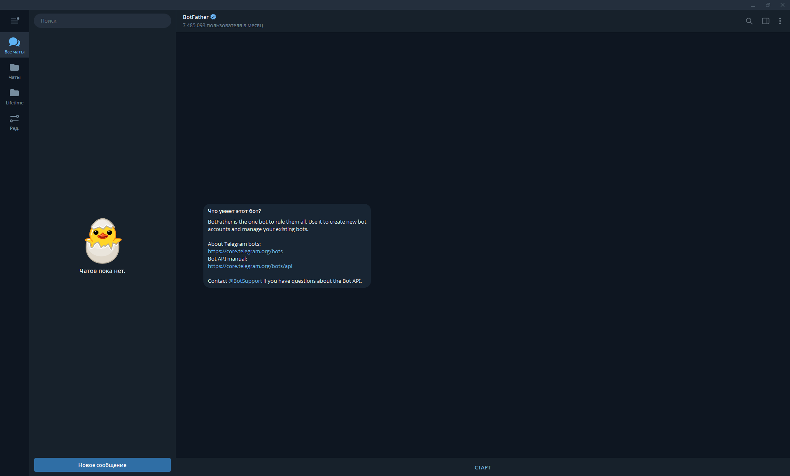

На снимке видна синяя официальная отметка рядом с именем **BotFather**. Пустая
история и кнопка **СТАРТ** являются нормальным состоянием нового или очищенного
диалога.

## 3.3. Запуск диалога с BotFather

Нажмите **СТАРТ** в нижней части окна. Telegram отправит системную команду
`/start`, а BotFather покажет список доступных команд.

Нужная для следующего шага команда:

```text
/newbot
```

Она создаёт новую учётную запись Telegram-бота. Это ещё не подключает бота к
Центру и не добавляет его в группы.

### Доказательство 5

После нажатия **СТАРТ** нужен снимок ответа BotFather со списком команд. В нём
должна быть видна строка `/newbot - create a new bot`. Токена на этом шаге ещё
нет.

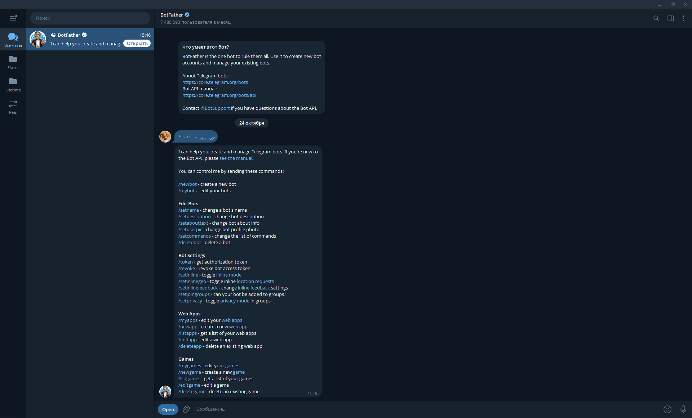

На экране появился полный список команд BotFather. Для создания нового бота нужна команда `/newbot` — она находится в самом начале списка, в разделе создания и управления ботами.

### 3.4. Создание центрального бота «Ту-96-Тест»

У бота будут два разных имени. Их нельзя путать:

- **отображаемое имя:** `Ту-96-Тест` — его будут видеть пользователи Telegram;
- **техническое имя (username):** `tu_96_test_bot` — уникальный адрес бота, записываемый латинскими буквами, цифрами и символом подчёркивания. Он обязательно должен оканчиваться на `bot`.

Если `tu_96_test_bot` уже занят, BotFather не создаст второго бота с таким же username. В этом случае в инструкции будет зафиксирован другой свободный вариант, выбранный во время настройки.

После создания BotFather выдаст токен. **Токен является секретным ключом:** его нельзя публиковать, пересылать посторонним или оставлять видимым на снимках экрана. Позже этот токен будет вставлен только в поле токена бота на странице **«Связь»** Центра EAVC Connect.

Следующее действие — отправить BotFather команду `/newbot` и дождаться запроса отображаемого имени.

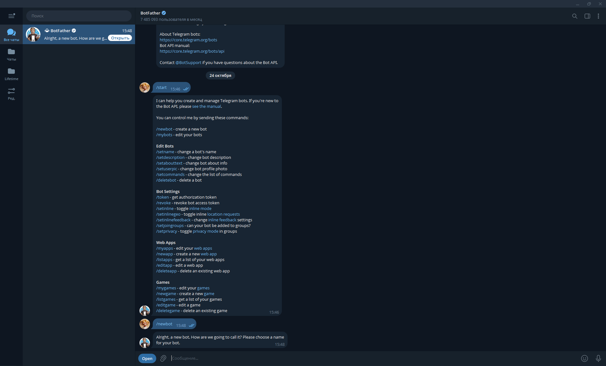

После команды `/newbot` BotFather пишет: **“Please choose a name for your bot”**. На этом шаге вводится именно видимое пользователям имя, а не адрес с символом `@`.

Для тестовой установки укажите:

```text
Ту-96-Тест
```

Дефисы и кириллица здесь разрешены. Окончание `bot` для отображаемого имени не требуется. После отправки этого имени BotFather отдельно попросит придумать технический username — это будет следующий шаг.

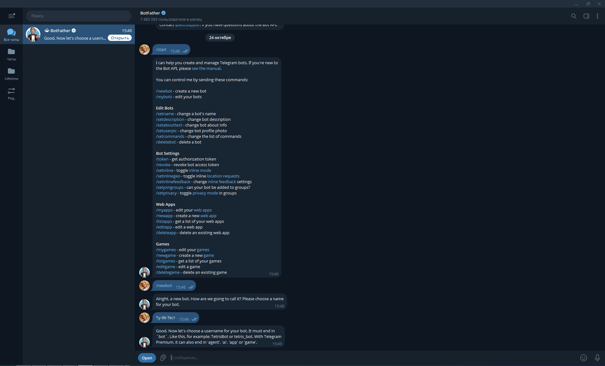

BotFather принял отображаемое имя `Ту-96-Тест` и запросил username. На этом шаге нужно соблюдать другие правила:

- использовать только латинские буквы, цифры и символ подчёркивания;
- не ставить пробелы и дефисы;
- обязательно закончить имя словом `bot`;
- выбрать имя, которое ещё никем не занято в Telegram.

Для этой установки сначала проверяем следующий вариант:

```text
tu_96_test_bot
```

Символ `@` при создании вводить не нужно. Если имя свободно, созданный адрес бота будет `@tu_96_test_bot`.

После принятия username BotFather создаст бота и покажет секретный токен. Перед созданием следующего снимка токен необходимо закрыть сплошной непрозрачной плашкой либо обрезать экран так, чтобы секрет целиком отсутствовал.

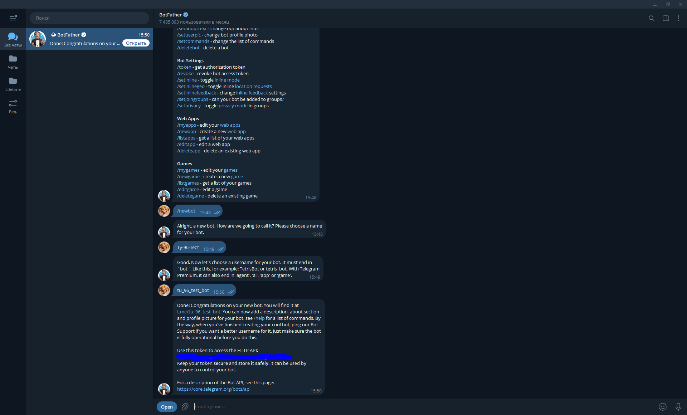

BotFather подтвердил создание бота и показал его адрес:

```text
@tu_96_test_bot
```

На снимке секретный токен закрыт непрозрачной плашкой. Так должны оформляться все иллюстрации, на которых сообщение BotFather с токеном попадает в кадр. Сам токен остаётся доступен владельцу в личном диалоге с BotFather и позже будет скопирован непосредственно в EAVC Connect.

Создание бота ещё не завершает его подготовку. Для транспортной схемы EAVC Connect у центрального бота требуется проверить три настройки:

1. добавление в группы разрешено;
2. Group Privacy отключён для центрального бота;
3. Bot-to-Bot Communication включён.

Эти параметры настраиваются через меню `/mybots`. Bot-to-Bot — отдельный режим: его нельзя заменить одним лишь отключением Group Privacy.

### 3.5. Открытие настроек центрального бота

Отправьте BotFather команду:

```text
/mybots
```

BotFather должен показать список ботов, принадлежащих текущему аккаунту. В нём необходимо выбрать `@tu_96_test_bot`. Другие существующие боты не изменяем.

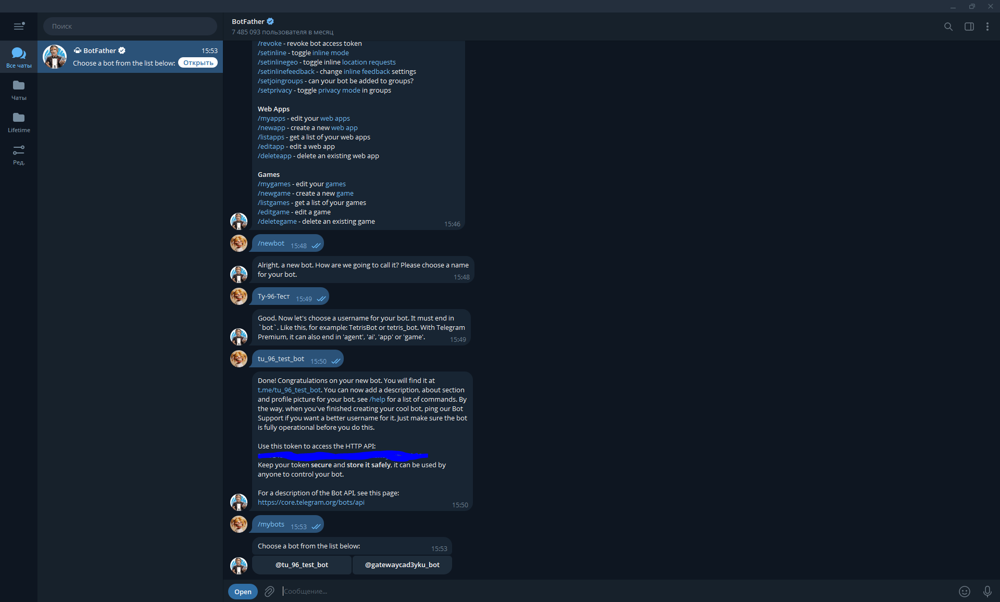

В списке видны два бота:

- `@tu_96_test_bot` — новый центральный бот тестовой системы, который сейчас настраиваем;
- `@gatewaycad3yku_bot` — ранее существовавший посторонний бот, который не относится к EAVC Connect и не должен изменяться.

Выберите кнопку `@tu_96_test_bot`. Следующий экран должен содержать меню управления именно этим ботом.

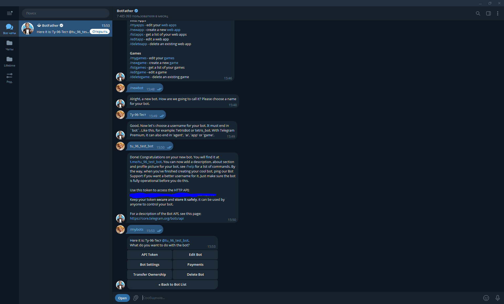

В верхней части сообщения BotFather обязательно перепроверьте имя и username: `Ту-96-Тест @tu_96_test_bot`. Это защищает от случайного изменения другого бота.

В этом меню:

- **API Token** повторно показывает или перевыпускает секретный токен;
- **Edit Bot** меняет имя, описание и изображение;
- **Bot Settings** открывает технические разрешения — нужен именно этот пункт;
- **Transfer Ownership** передаёт владение другому аккаунту;
- **Delete Bot** безвозвратно удаляет бота.

Нажмите **Bot Settings**. Остальные кнопки на этом шаге не используйте.

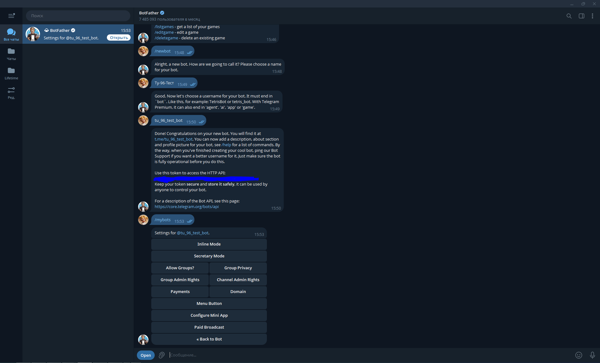

В текущей версии интерфейса BotFather показаны **Allow Groups?**, **Group Privacy** и другие параметры. Пункт **Secretary Mode** относится к подключению бизнес-аккаунтов и для EAVC Connect не используется.

На этом экране отсутствует отдельная кнопка **Bot-to-Bot Communication**. По актуальной официальной документации Telegram этот режим всё равно обязателен для нашей схемы. После защиты токена откроем современное меню BotFather и найдём его отдельно; отключение Group Privacy не является заменой Bot-to-Bot.

> **Безопасность:** если токен хотя бы частично попал на снимок, рекомендуется отозвать его командой `/revoke`. Одного закрашивания последующей копии изображения недостаточно. В публикуемые материалы снимки с читаемым токеном не включаются.

Первым проверяем разрешение добавлять бота в группы. Нажмите **Allow Groups?** и прочитайте текущий статус, ничего не переключая до проверки.

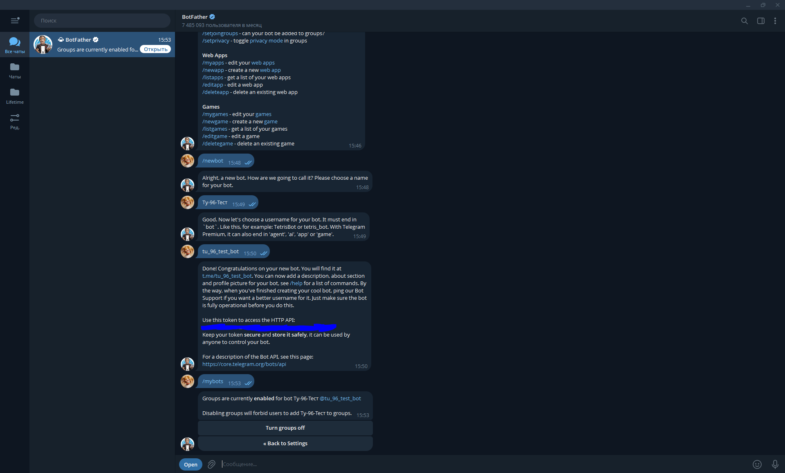

Фраза **“Groups are currently enabled”** означает, что нужное разрешение уже включено. Кнопка **Turn groups off** показывает доступное действие, а не текущий режим: нажимать её не нужно, иначе бот перестанет добавляться в группы.

Вернитесь кнопкой **Back to Settings**, затем откройте **Group Privacy**. Сначала проверяем показанное состояние и только потом принимаем решение о переключении.

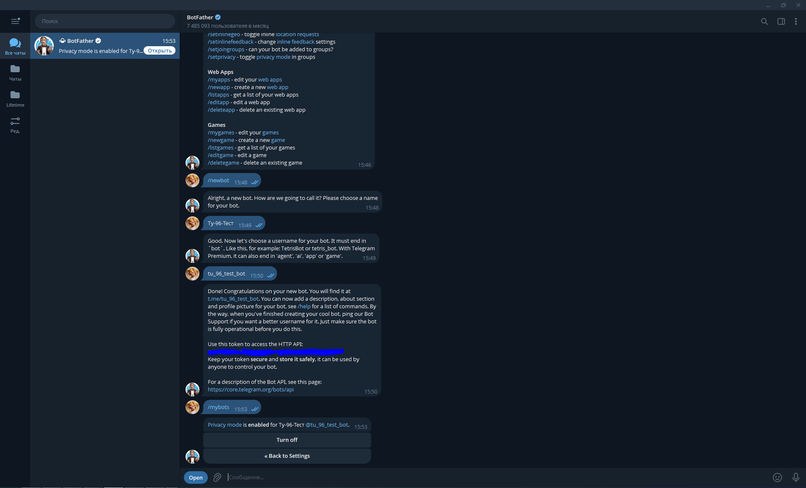

Фраза **“Privacy mode is enabled”** подтверждает, что Group Privacy сейчас включён. Для центрального бота EAVC Connect его необходимо отключить: центр должен принимать в закрытой транспортной группе служебные пакеты, отправленные ботами рабочих точек.

Нажмите **Turn off**. После изменения BotFather должен явно подтвердить, что privacy mode отключён.


Фраза **“Privacy mode is disabled”** подтверждает правильное состояние. Кнопка теперь называется **Turn on**, поскольку она предлагает снова включить режим; нажимать её не нужно.

Итого уже настроено:

- добавление в группы — разрешено;
- Group Privacy центрального бота — отключён.

Остаётся включить отдельный **Bot-to-Bot Communication Mode**. В показанном классическом меню этой кнопки нет, поэтому откроем современное меню BotFather кнопкой **Open** в нижней левой части окна Telegram.

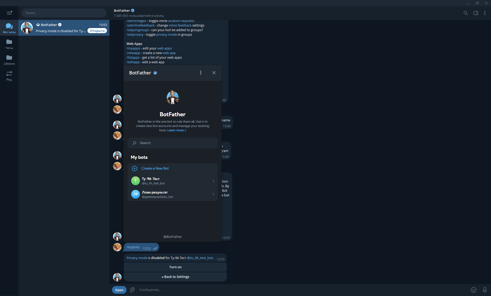

Открылось встроенное современное меню BotFather. В разделе **My bots** снова показаны:

- `Ту-96-Тест`, `@tu_96_test_bot` — настраиваем его;
- `Лови результат`, `@gatewaycad3yku_bot` — не относится к этой системе, не открываем и не изменяем.

Нажмите строку **Ту-96-Тест**. Не используйте **Create a New Bot**, поскольку нужный бот уже создан.

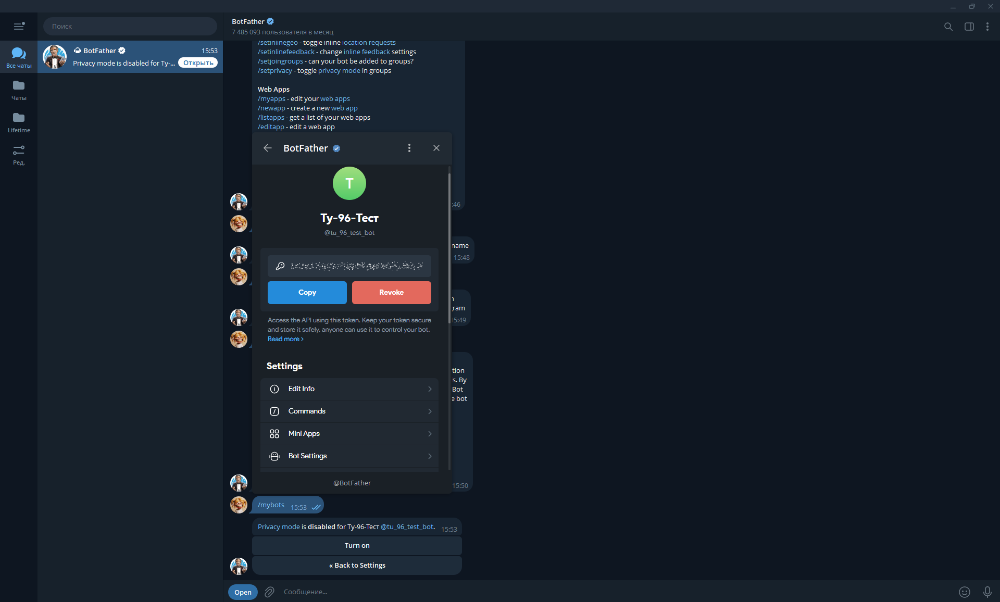

В карточке снова проверьте заголовок `Ту-96-Тест` и username `@tu_96_test_bot`. Верхний блок предназначен для работы с токеном:

- **Copy** копирует секретный токен;
- **Revoke** отзывает текущий токен и создаёт новый.

При обычной настройке эти кнопки не нажимаются. В разделе **Settings** выберите **Bot Settings** — там находятся технические режимы бота.

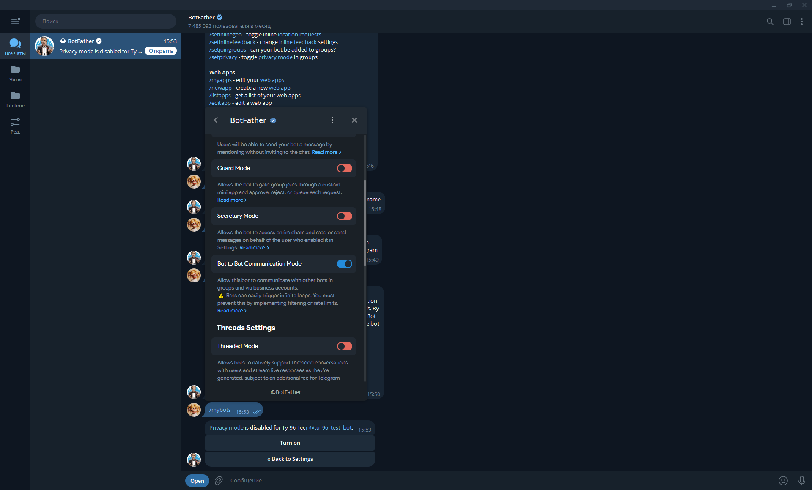

Переключатель **Bot to Bot Communication Mode** синий, а ползунок находится справа — режим уже включён. Переключать его не нужно.

На этом же экране видны другие режимы:

- **Guard Mode** — выключен, для нашей транспортной схемы не требуется;
- **Secretary Mode** — выключен, доступ к переписке пользовательского аккаунта системе не нужен;
- **Threaded Mode** — выключен, это режим личных диалогов с ботом, а не темы форумной супергруппы.

Основные параметры центрального бота заданы: Allow Groups включён, Group Privacy выключен, Bot-to-Bot Communication включён. Ниже приведена дополнительная сверка всего современного экрана настроек.

#### Полный обзор современного меню Bot Settings

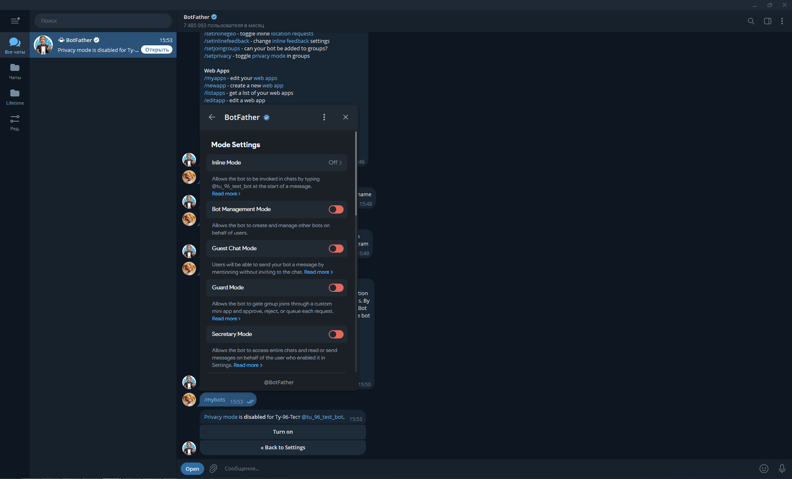

В верхней части меню установлены следующие состояния:

- **Inline Mode — Off:** правильно, вызов бота через `@username` в обычных чатах системе не нужен;
- **Bot Management Mode — выключен:** правильно, центральный бот не должен создавать и администрировать другие боты;
- **Guest Chat Mode — выключен:** правильно, приглашение бота в чужой чат через упоминание не используется;
- **Guard Mode — выключен:** правильно, отдельное приложение согласования вступления в группы не используется;
- **Secretary Mode — выключен:** правильно, боту не нужен доступ к переписке от имени личного аккаунта.

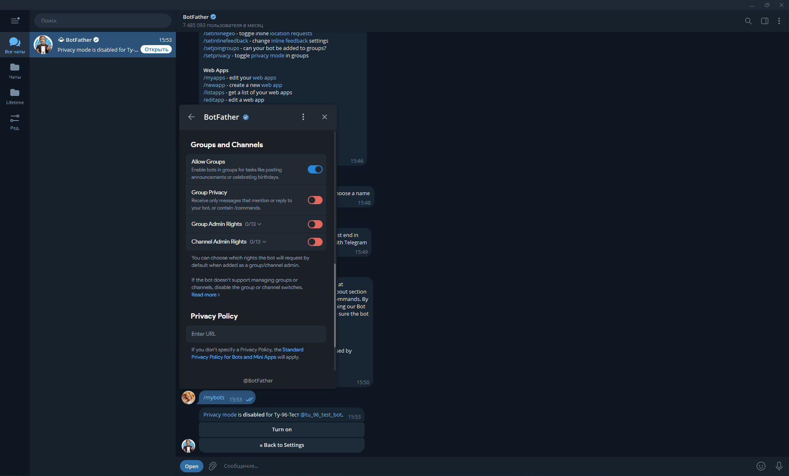

В разделе **Groups and Channels**:

- **Allow Groups** должен быть включён;
- **Group Privacy** у центрального бота должен быть выключен;
- **Group Admin Rights 0/13** не означает, что бот лишён прав в конкретной группе. Это только перечень прав, которые бот будет автоматически запрашивать при добавлении. Нужные права выдадим вручную внутри транспортной группы;
- **Channel Admin Rights 0/13** можно оставить выключенным: каналы в транспортной схеме не используются;
- собственный адрес Privacy Policy можно не задавать — применяется стандартная политика Telegram.

После повторного открытия современного меню состояние синхронизировалось правильно: **Allow Groups** отображается синим и включён, а **Group Privacy** — красным и выключен. Это совпадает с подтверждением классического меню BotFather. Настройка центрального бота завершена.

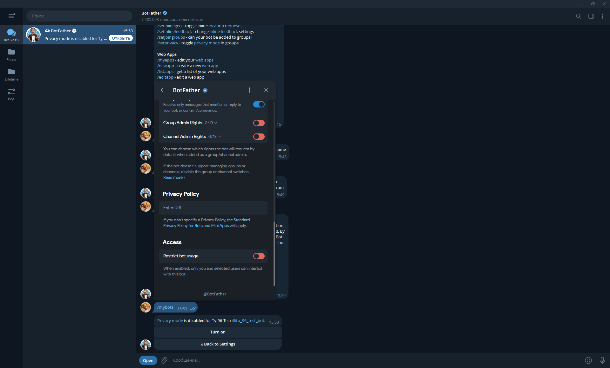

**Restrict bot usage** оставляем выключенным. Доступ к транспортной системе ограничивается закрытой группой, списком зарегистрированных ботов, сверкой отправителя, группы и темы, а не этим пользовательским режимом BotFather.

### 3.6. Создание бота рабочей точки «Текстиль-Тест»

Для каждой рабочей точки используется отдельный бот. Нельзя использовать один общий токен для трёх компьютеров: подтверждение доставки и служебный ответ должны однозначно относиться к конкретной точке.

Первый бот рабочей точки создаём со следующими именами:

```text
Отображаемое имя: Текстиль-Тест
Username:           eavc_textile_test_bot
```

Если предложенный username уже занят, выбирается другой свободный вариант и он обязательно фиксируется в инструкции и в настройках Центра.

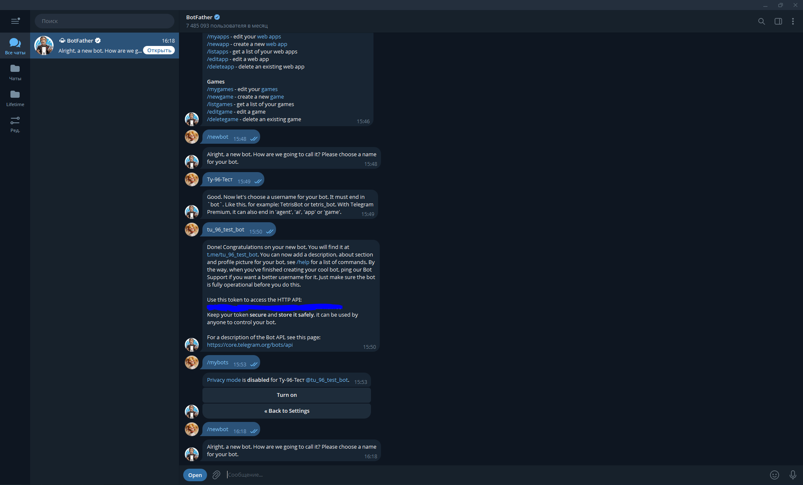

После новой команды `/newbot` BotFather снова просит видимое имя. Введите точно:

```text
Текстиль-Тест
```

После этого BotFather запросит уникальный username рабочей точки.

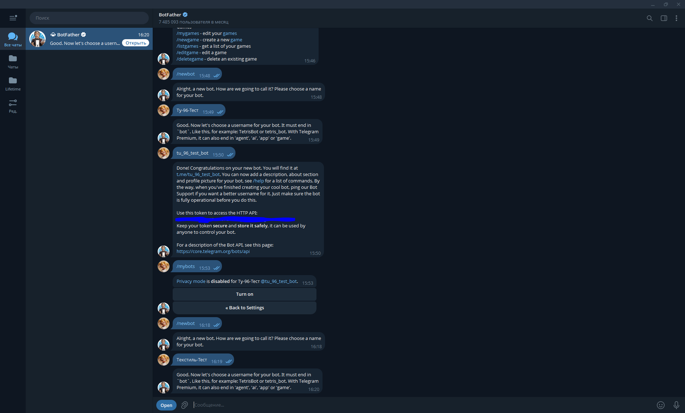

BotFather принял отображаемое имя `Текстиль-Тест`. Теперь введите технический username:

```text
eavc_textile_test_bot
```

Если username свободен, BotFather создаст бот рабочей точки и выдаст отдельный токен. Этот токен не должен совпадать с токеном центра и не должен попадать на снимок.

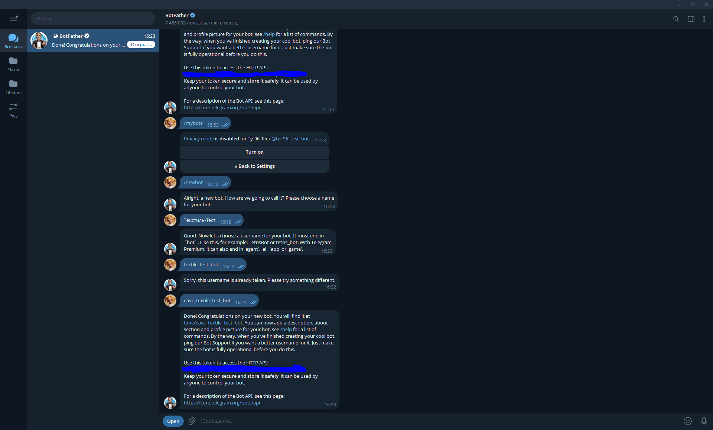

На реальном шаге сначала был введён username `textile_test_bot`, но BotFather ответил **“this username is already taken”**. Это не ошибка настройки: usernames Telegram уникальны во всём мире. После ввода согласованного варианта `eavc_textile_test_bot` бот был успешно создан.

Итоговые данные первой рабочей точки:

```text
Отображаемое имя: Текстиль-Тест
Username:           @eavc_textile_test_bot
```

Токен этого бота отдельный и секретный. На снимке закрыты как токен центра, так и токен Текстиля.

Теперь бот рабочей точки нужно подготовить к транспортной группе. Для него должны быть включены **Allow Groups** и **Bot-to-Bot Communication**. Group Privacy можно оставить включённым: бот точки отправляет файлы в свою тему, а не собирает все сообщения группы.

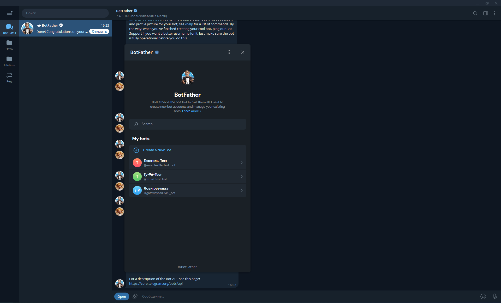

В списке теперь три записи:

- `Текстиль-Тест @eavc_textile_test_bot` — бот рабочей точки, настраиваем сейчас;
- `Ту-96-Тест @tu_96_test_bot` — уже настроенный центральный бот;
- `Лови результат @gatewaycad3yku_bot` — посторонний бот, не изменяем.

Откройте строку **Текстиль-Тест**, затем в его карточке выберите **Bot Settings**.

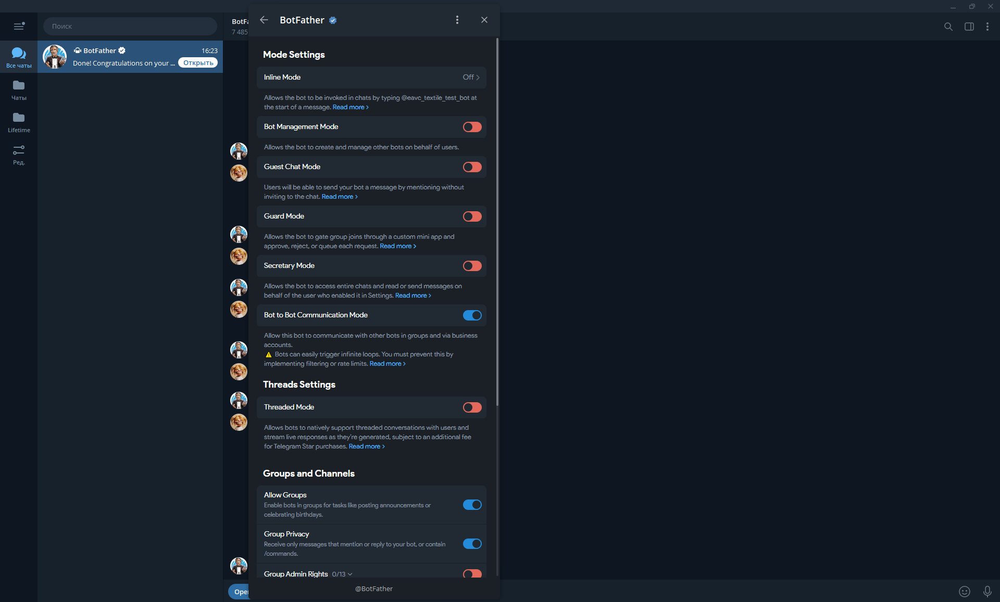

На одном экране подтверждены все обязательные параметры бота рабочей точки:

- **Bot to Bot Communication Mode** — синий, включён;
- **Allow Groups** — синий, включён;
- **Group Privacy** — синий, включён; для отправляющего бота точки это допустимо и уменьшает объём получаемых групповых сообщений;
- **Inline, Bot Management, Guest Chat, Guard, Secretary и Threaded Mode** — выключены, они EAVC Connect не нужны.

Настройка `Текстиль-Тест` завершена.

### 3.7. Создание бота рабочей точки «Селидово-Тест»

Для второй точки используем:

```text
Отображаемое имя: Селидово-Тест
Username:           eavc_selidovo_test_bot
```

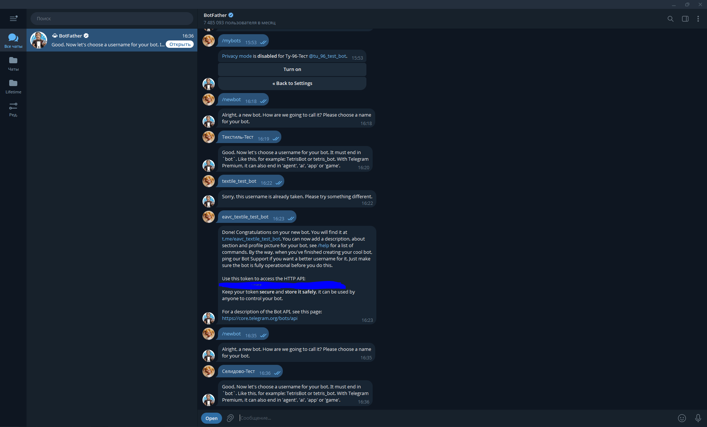

Отображаемое имя `Селидово-Тест` принято. На следующем шаге введите:

```text
eavc_selidovo_test_bot
```

После создания зафиксируйте итоговый username и сохраните выданный токен отдельно от токенов центра и Текстиля.

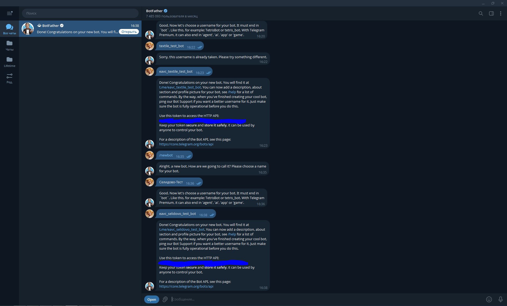

BotFather подтвердил адрес второго бота рабочей точки:

```text
@eavc_selidovo_test_bot
```

Токены уже созданных ботов закрыты на снимке. Для `Селидово-Тест` проверяем ту же конфигурацию, что и для Текстиля: Bot-to-Bot и Allow Groups включены, Group Privacy можно оставить включённым, остальные специальные режимы выключены.

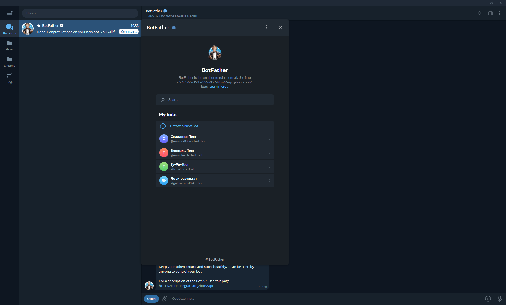

В современном меню видно, что `Селидово-Тест` зарегистрирован отдельно от `Текстиль-Тест` и `Ту-96-Тест`.

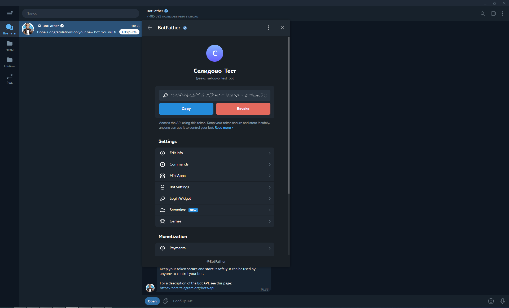

Перед открытием настроек ещё раз сверяется username `@eavc_selidovo_test_bot`. Кнопки **Copy** и **Revoke** не используются.

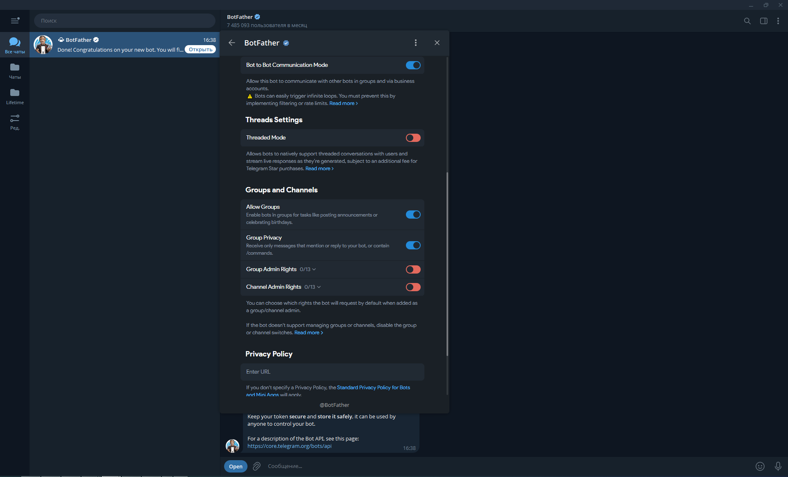

Проверка подтверждает:

- **Bot to Bot Communication Mode** включён;
- **Allow Groups** включён;
- **Group Privacy** включён;
- **Threaded Mode**, запрашиваемые права администратора группы и канала выключены.

Настройка `Селидово-Тест` завершена.

### 3.8. Создание бота рабочей точки «Весёлое-Тест»

Для третьей точки используем:

```text
Отображаемое имя: Весёлое-Тест
Username:           eavc_vesyoloe_test_bot
```

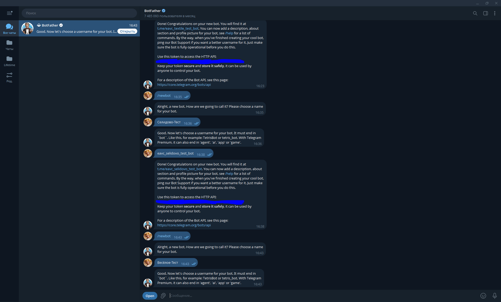

После принятия отображаемого имени введите:

```text
eavc_vesyoloe_test_bot
```

Транслитерация `vesyoloe` фиксируется одинаково в username, настройках Центра и документации. Отображаемое русское имя при этом остаётся `Весёлое-Тест`.

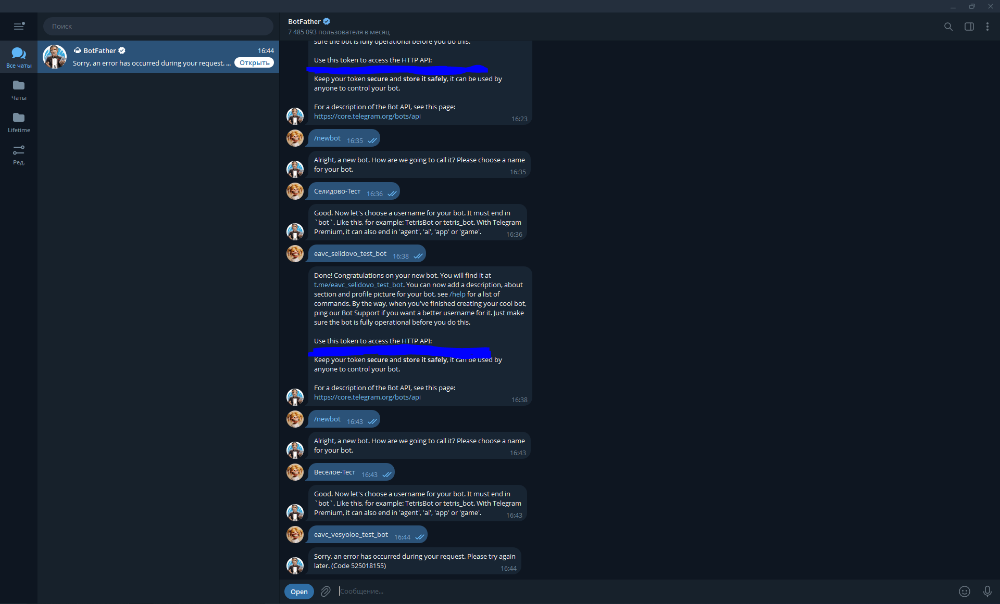

При первом вводе `eavc_vesyoloe_test_bot` BotFather вернул сообщение **“an error has occurred during your request. Please try again later”** с кодом `525018155`. Это отличается от сообщения **“username is already taken”**: BotFather не сообщил, что выбранное имя занято.

Не отправляйте несколько повторов подряд. Подождите несколько минут и повторите тот же username один раз. Если BotFather уже вышел из диалога создания, снова выполните `/newbot`, укажите `Весёлое-Тест`, а затем `eavc_vesyoloe_test_bot`.

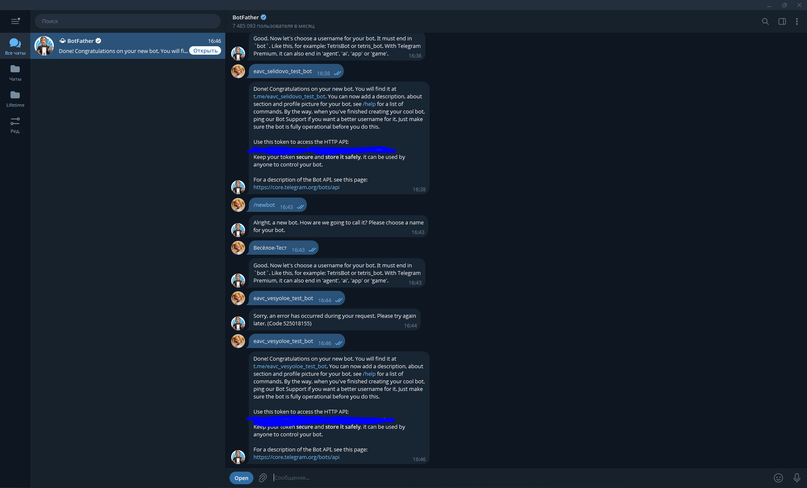

Через несколько минут повтор того же username прошёл успешно. Итоговый адрес третьего бота:

```text
@eavc_vesyoloe_test_bot
```

Повторная попытка не создала лишнего бота: до сообщения **Done!** создание не было завершено. Токены Селидово и Весёлого на снимке закрыты.

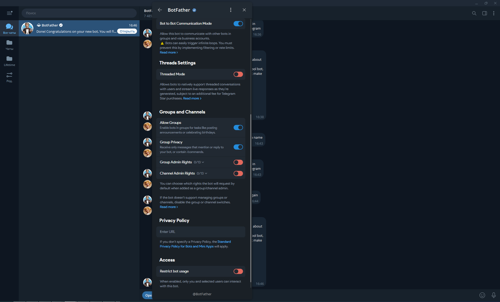

На контрольном экране для `Весёлое-Тест` подтверждено:

- **Bot to Bot Communication Mode** включён;
- **Allow Groups** включён;
- **Group Privacy** включён;
- **Threaded Mode**, запрашиваемые права администратора группы и канала и **Restrict bot usage** выключены.

Это правильная конфигурация бота рабочей точки: он сможет находиться в транспортной группе и обмениваться сообщениями с центральным ботом, но не будет получать все посторонние сообщения группы. Настройка `Весёлое-Тест` завершена.

### 3.9. Итог проверки созданных ботов

К этому моменту созданы и настроены четыре бота:

- центральный: `Ту-96-Тест` — `@tu_96_test_bot`;
- рабочая точка: `Текстиль-Тест` — `@eavc_textile_test_bot`;
- рабочая точка: `Селидово-Тест` — `@eavc_selidovo_test_bot`;
- рабочая точка: `Весёлое-Тест` — `@eavc_vesyoloe_test_bot`.

У центрального бота **Group Privacy** выключен. У трёх ботов рабочих точек он включён. У всех четырёх ботов включены **Allow Groups** и **Bot to Bot Communication Mode**.

# Этап 4. Создание закрытой транспортной группы

## 4.1. Создание закрытой транспортной группы

Транспортная группа служит внутренним каналом обмена между центральным ботом и ботами рабочих точек. Пользовательские группы получателей будут созданы отдельно и не должны заменять эту группу.

В меню Telegram выберите создание новой группы. После выбора первоначального участника Telegram откроет окно ввода названия:

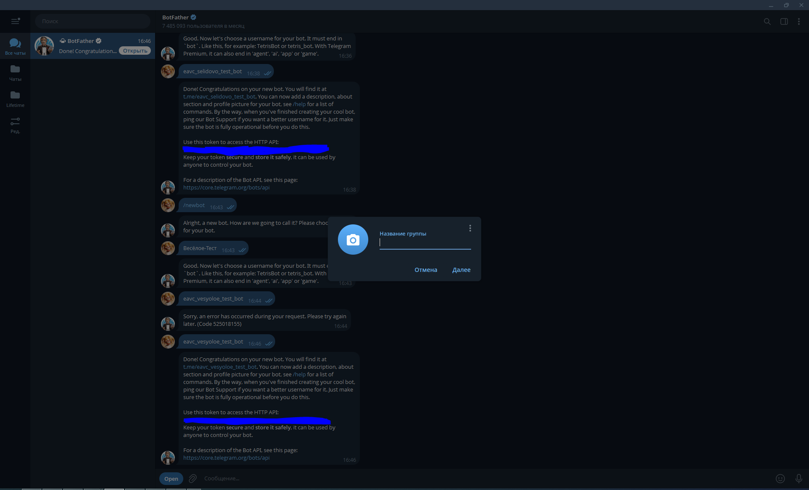

Введите название точно в таком виде:

```text
EAVC-Обмен-Тест
```

На этом шаге фотографию группы можно не добавлять. Нажмите **Далее** для завершения создания группы.

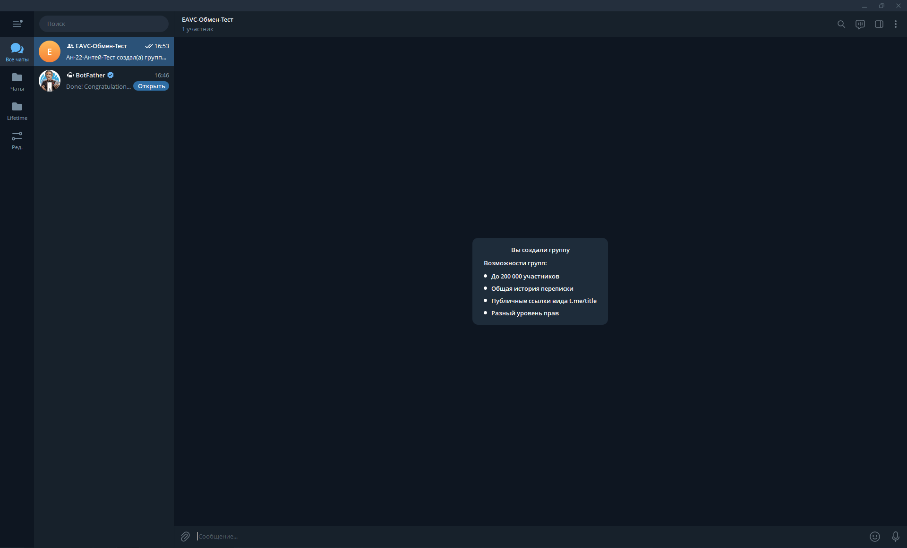

После создания Telegram показывает системное сообщение **«Вы создали группу»**. В заголовке указано `1 участник`: пока в группе находится только аккаунт администратора `Ан-22-Антей-Тест`. Боты будут добавлены после включения режима тем.

## 4.2. Открытие управления транспортной группой

Нажмите название `EAVC-Обмен-Тест` в верхней части окна. Откроется карточка группы, из которой можно перейти к её настройкам и включить темы.

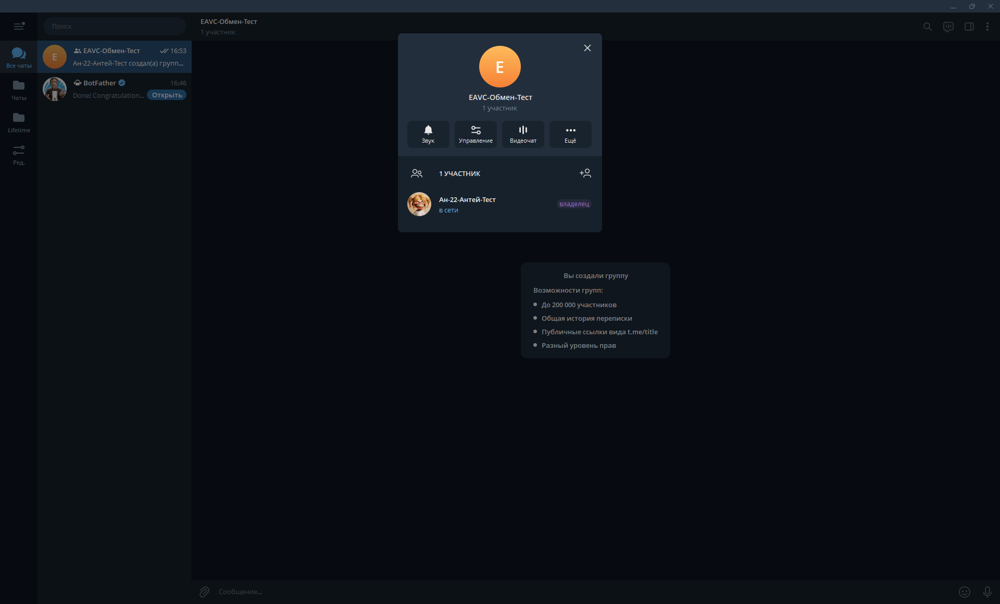

Карточка подтверждает, что владельцем группы является `Ан-22-Антей-Тест`, а других участников пока нет. Нажмите **Управление** — кнопку с изображением ползунков.

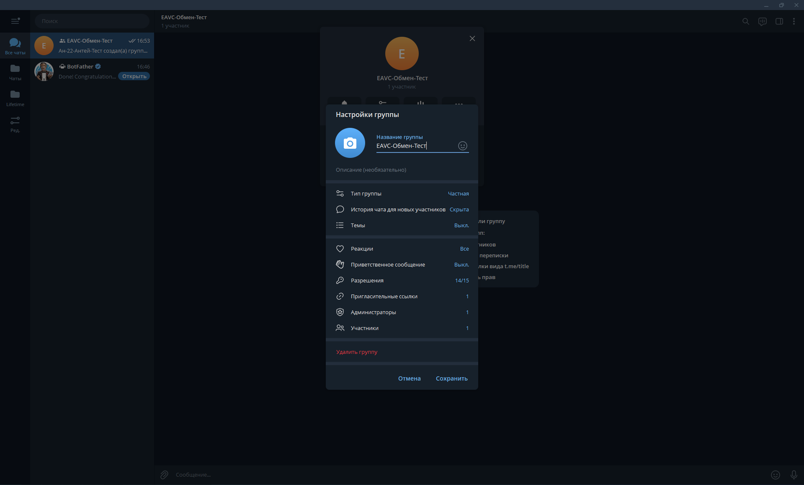

В исходном состоянии видно:

- **Тип группы** — `Частная`;
- **История чата для новых участников** — `Скрыта`;
- **Темы** — `Выкл.`.

Транспортная группа должна оставаться частной. Для разделения обмена по рабочим точкам нажмите строку **Темы**. В текущей версии Telegram значение справа меняется с `Выкл.` на `Вкладки`. Это означает, что темы включены и будут отображаться в верхней части группы как вкладки. В другой версии клиента вместо `Вкладки` может отображаться `Вкл.`.

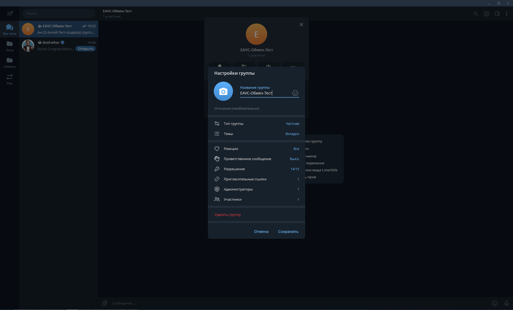

Другие параметры на этом экране не меняйте. Нажмите **Сохранить**.

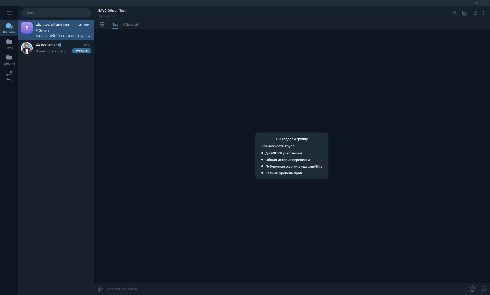

Сохранение прошло успешно: над областью сообщений появились вкладки **Все** и **General**, а в поле ввода указано **«Написать в General»**. Это подтверждает, что группа преобразована в форум с темами.

Служебную тему `General` не переименовывайте и не используйте как замену темам рабочих точек. Для каждой точки будет создана отдельная тема с точным именем без суффикса `-Тест`.

## 4.3. Создание тем рабочих точек

Откройте меню группы кнопкой с тремя точками в правом верхнем углу окна Telegram. В меню должна быть доступна команда создания темы.

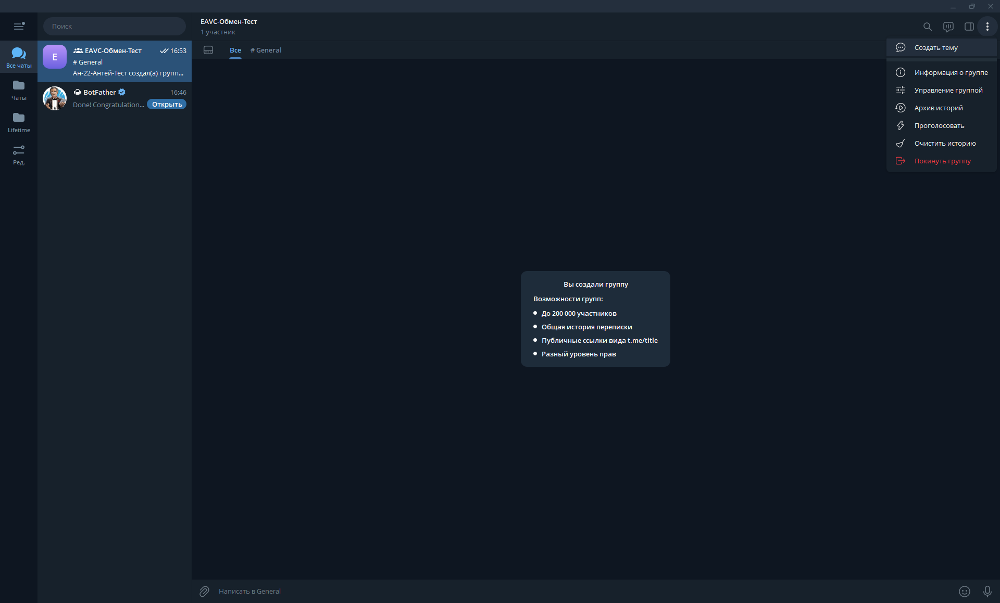

Команда **Создать тему** находится в верхней строке меню. Нажмите её, чтобы открыть окно создания первой темы.

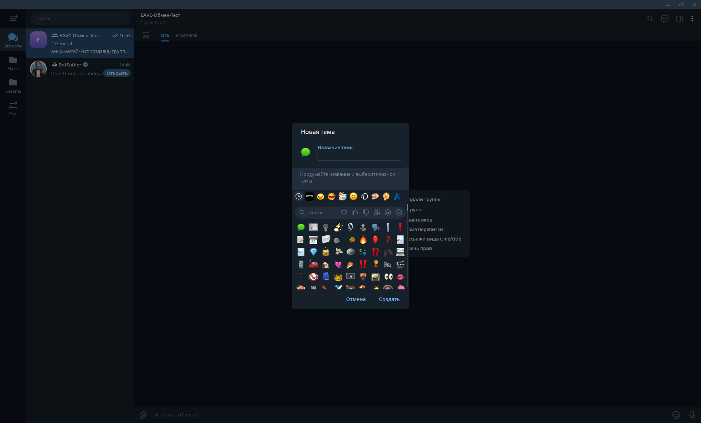

Для транспортной группы нужны три отдельные темы с точными именами:

- `Текстиль`;
- `Селидово`;
- `Весёлое`.

Суффикс `-Тест` в названия тем не добавляется. Для первой темы введите `Текстиль`. Значок темы не влияет на маршрутизацию, поэтому его можно оставить выбранным автоматически.

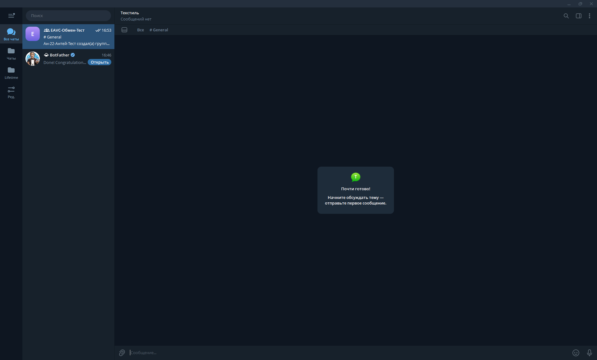

В заголовке отображается `Текстиль`, а Telegram сообщает **«Почти готово! Начните обсуждать тему — отправьте первое сообщение»**. Отправлять пробное сообщение сейчас не требуется: тема уже создана.

Темы `Селидово` и `Весёлое` создаются полностью тем же способом:

1. Откройте меню группы **⋮** и выберите **Создать тему**.
2. Введите точное название `Селидово`, оставьте любой значок и нажмите **Создать**.
3. Ещё раз выберите **Создать тему**.
4. Введите точное название `Весёлое`, оставьте любой значок и нажмите **Создать**.

Не добавляйте к названиям тем суффикс `-Тест` и не отправляйте в них пробные сообщения. После создания проверьте общий список: в группе должны быть темы `General`, `Текстиль`, `Селидово` и `Весёлое`.

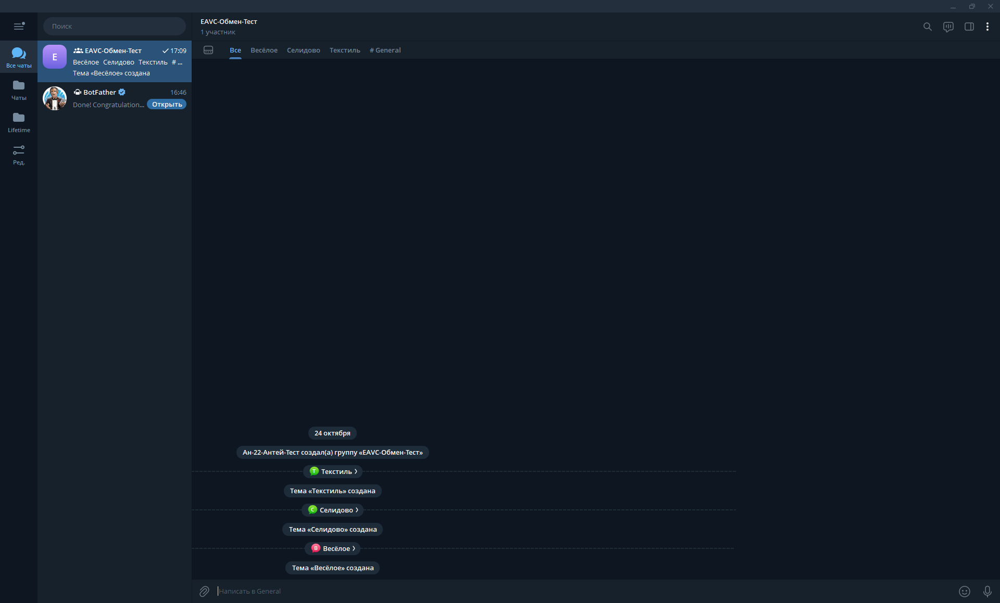

Контрольный экран подтверждает наличие четырёх вкладок тем: `Весёлое`, `Селидово`, `Текстиль` и служебной темы `General`. Порядок вкладок Telegram определяет автоматически; на маршрутизацию он не влияет.

## 4.4. Добавление ботов в транспортную группу

В группу необходимо добавить все четыре созданных бота. Сначала нажмите название `EAVC-Обмен-Тест` в верхней части окна, чтобы снова открыть карточку группы.

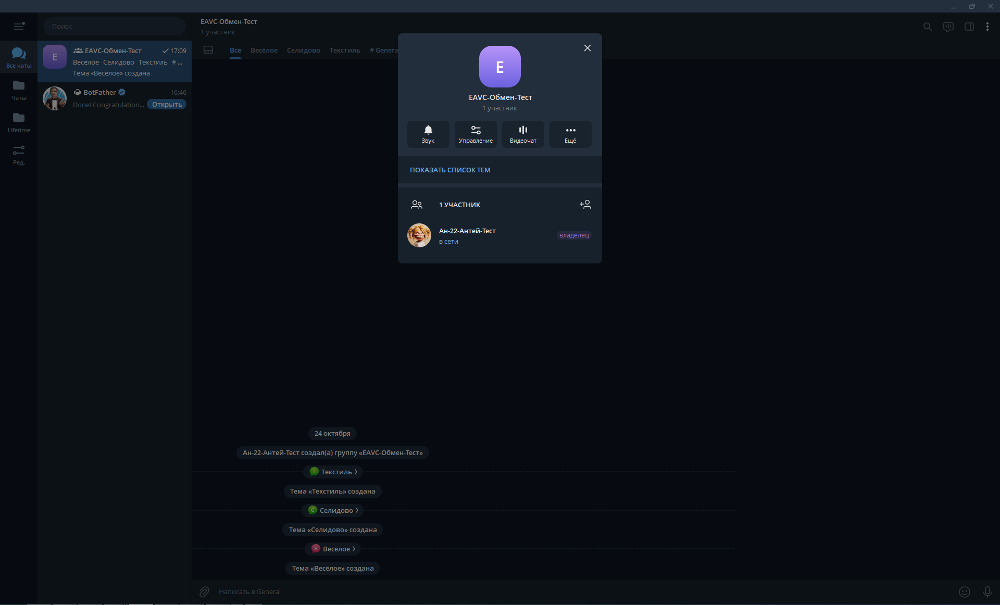

Справа от заголовка **1 участник** расположена кнопка с изображением человека и знака `+`. Нажмите её, чтобы открыть выбор новых участников.

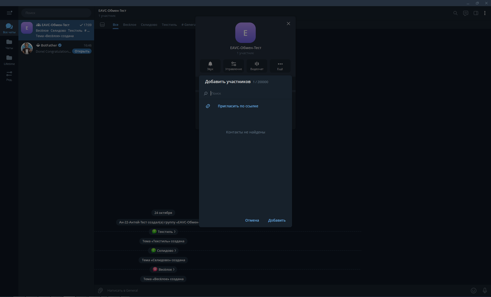

Если список контактов пуст, используйте поле **Поиск**. По очереди найдите и отметьте четыре точных username:

- `@tu_96_test_bot`;
- `@eavc_textile_test_bot`;
- `@eavc_selidovo_test_bot`;
- `@eavc_vesyoloe_test_bot`.

Сверяйте не только отображаемое имя, но и username результата. Постороннего бота `@gatewaycad3yku_bot` в транспортную группу не добавляйте. После выбора всех четырёх проверьте список перед нажатием **Добавить**.

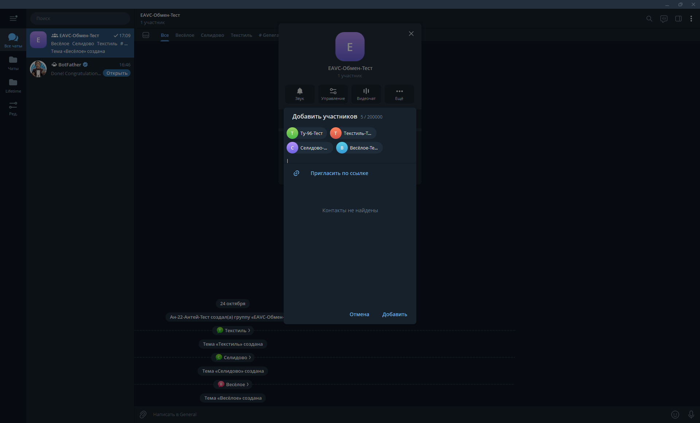

В верхней части окна должны отображаться четыре выбранных аккаунта: `Ту-96-Тест`, `Текстиль-Тест`, `Селидово-Тест` и `Весёлое-Тест`. Счётчик `5 / 200000` учитывает также уже находящегося в группе владельца. Нажмите **Добавить**.

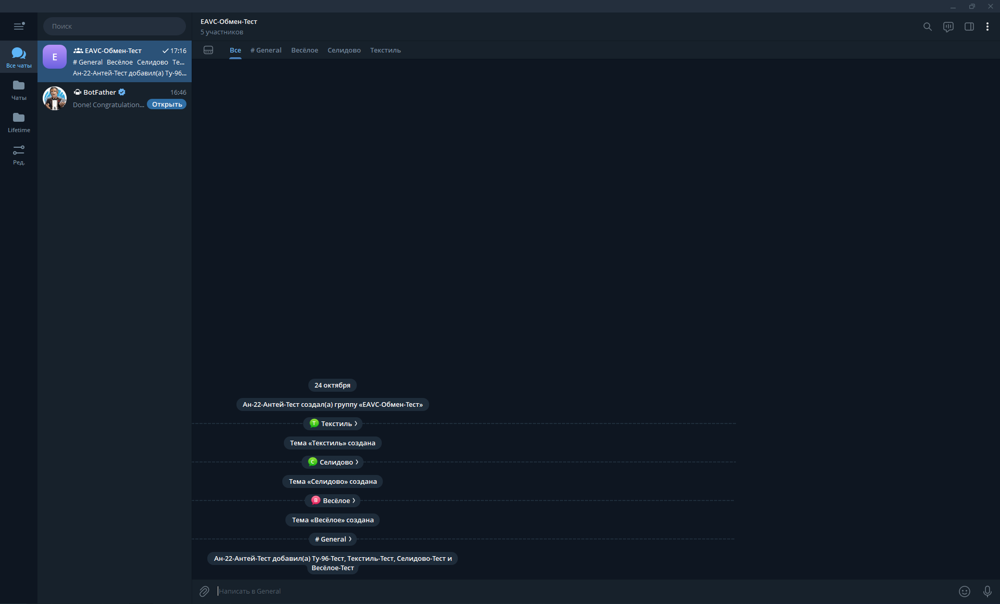

После добавления в заголовке отображается **5 участников**: владелец и четыре бота. Системное сообщение перечисляет `Ту-96-Тест`, `Текстиль-Тест`, `Селидово-Тест` и `Весёлое-Тест`, поэтому состав группы подтверждён.

Боты рабочих точек остаются обычными участниками. Центральный бот `Ту-96-Тест` должен стать администратором транспортной группы, чтобы читать и отправлять сообщения, работать с темами и удалять обработанные служебные сообщения.

## 4.5. Назначение центрального бота администратором

Откройте карточку группы, нажмите **Управление**, затем выберите **Администраторы**. До выбора нового администратора список содержит только владельца группы.

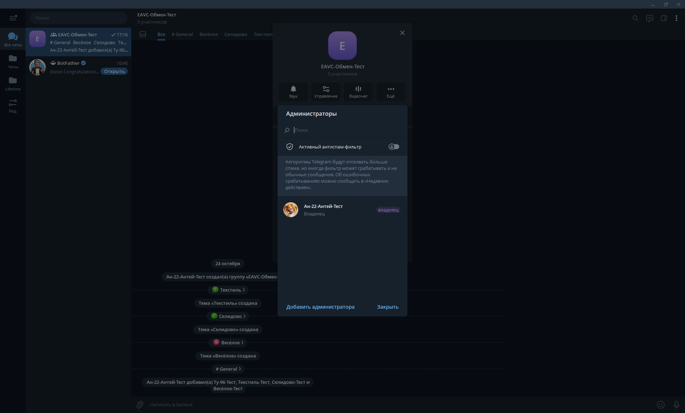

В списке пока находится только владелец `Ан-22-Антей-Тест`. Переключатель **Активный антиспам-фильтр** не изменяйте. Нажмите **Добавить администратора** и выберите только центрального бота `Ту-96-Тест` (`@tu_96_test_bot`).

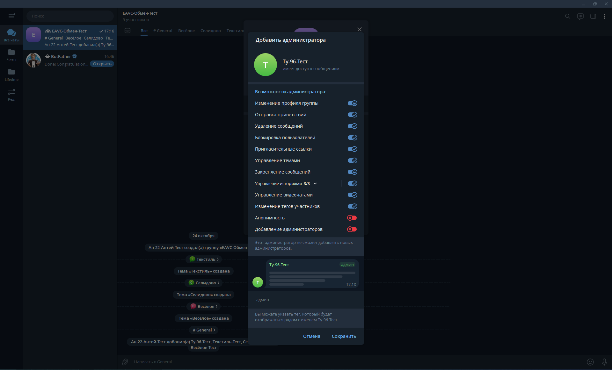

Telegram по умолчанию включает больше прав, чем требуется EAVC Connect. Примените принцип минимальных полномочий: среди переключаемых разрешений оставьте включёнными только:

- **Удаление сообщений** — нужно для удаления обработанных служебных файлов из транспортной группы;
- **Управление темами** — нужно для устойчивой работы в форумной группе.

Выключите остальные доступные синие переключатели: **Отправка приветствий**, **Блокировка пользователей**, **Пригласительные ссылки**, **Управление историями**, **Управление видеочатами** и **Изменение тегов участников**. **Анонимность** и **Добавление администраторов** должны оставаться выключенными.

Пункты с изображением замка, например **Изменение профиля группы** и **Закрепление сообщений**, наследуются из общих разрешений группы и на этом экране не переключаются — оставьте их как есть.

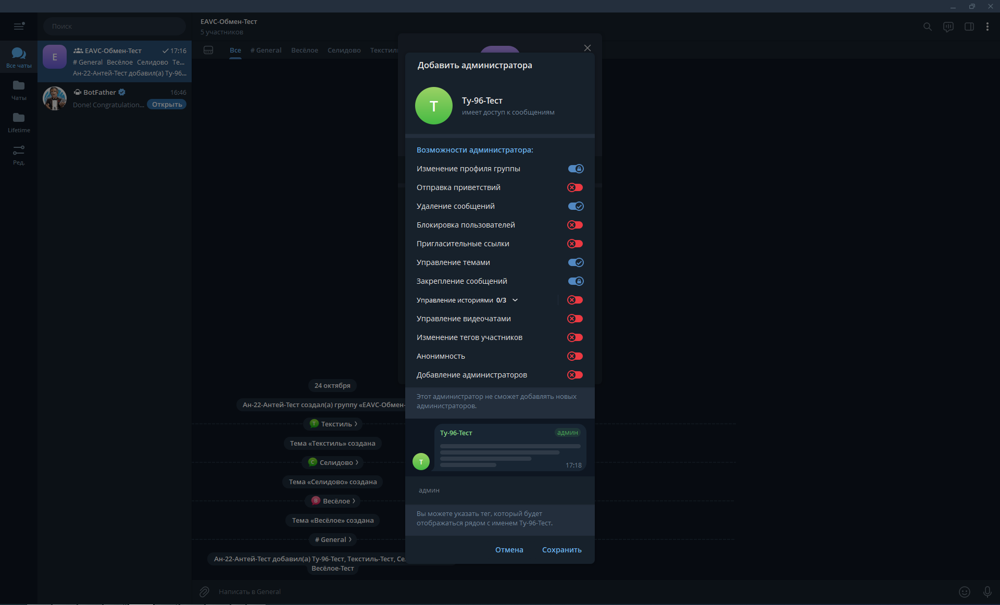

На контрольном экране **Удаление сообщений** и **Управление темами** отмечены синим, все прочие переключаемые полномочия — красным. Нажмите **Сохранить**, чтобы назначить `Ту-96-Тест` администратором.

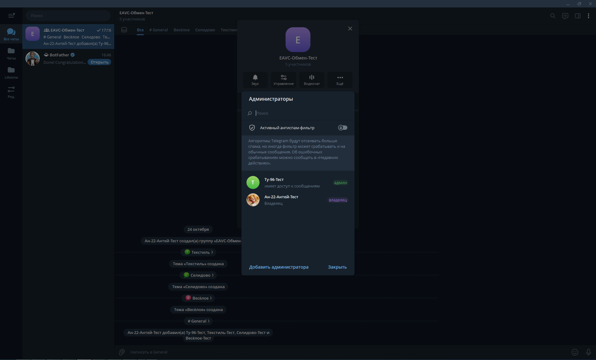

В списке администраторов теперь находятся:

- `Ан-22-Антей-Тест` — владелец;
- `Ту-96-Тест` — администратор с доступом к сообщениям.

Транспортная группа подготовлена: она частная, содержит четыре необходимые темы и всех четырёх ботов; административные права выданы только центральному боту.

# Этап 5. Создание групп получателей

## 5.1. Создание группы получателя «Аэродром-Тест»

Закройте окна управления и через главное меню Telegram снова выберите **Создать группу**. Первая группа получателя должна называться точно `Аэродром-Тест`. Ботов рабочих точек в неё добавлять нельзя: в группе получателя будет использоваться только центральный бот `Ту-96-Тест`.


Исходное состояние правильное: группа частная и содержит только владельца.


В окне управления сначала нажмите строку **Темы**: значение справа должно измениться с `Выкл.` на `Вкладки`.


Нажмите **Сохранить**. Появление вкладок **Все** и **General** подтверждает, что настройка применена:


Служебную тему `General` оставьте. Затем через меню группы последовательно создайте рабочие темы. Название каждой темы вводите точно, включая регистр, пробелы, кавычки и сокращения.

Первая тема — `1 мб 155 омбр`:


После нажатия **Создать** новая вкладка появляется рядом с `General`. Сообщение **«Почти готово!»** подтверждает успешное создание темы; отправлять в неё пробное сообщение не нужно:


Полный набор рабочих тем `Аэродром-Тест`:

1. `1 мб 155 омбр`
2. `мпб 32 омбр`
3. `3 об 3 обр ОсН "Спартан" НГУ`
4. `н/у подразделение ВСУ`
5. `управление 9 АК`
6. `10 абатр 4 гадн 55 оабр`
7. `1 бмп 38 обрмп`
8. `2 пдб 25 овдбр`
9. `2 еб 152 оебр`
10. `503 обмп 38 обрмп`
11. `управление 25 овдбр`
12. `1 аэмб 68 оаэмбр`
13. `3 мб 155 омбр`
14. `4 пдб 25 овдбр`
15. `59 ошбр СБпС`
16. `2 мб 1 отмбр`
17. `2 мб 32 омбр`
18. `б НПУ г. Павлоград`
19. `п/п 81 обу 9 АК`
20. `3 мб 160 омбр`
21. `11 абатр 4 гадн 55 оабр`
22. `12 абатр 4 гадн 55 оабр`
23. `Оповещения ПВО ВСУ`

> **Важно:** не создавайте отдельные темы с окончанием `(отложенный режим)`. Оператор EAVC может ввести полное название, например `503 обмп 38 обрмп (отложенный режим)`. При поиске маршрута Go-сервер временно уберёт только это конечное окончание и отправит перехват в обычную тему `503 обмп 38 обрмп`. При этом в самом сообщении Telegram и в материалах Word полное исходное название вместе с пометкой сохранится. Аналогично тема должна называться `управление 25 овдбр`, без дополнительного текста.

На следующем экране большинство тем создано правильно, но две темы с окончанием `(отложенный режим)` требуют переименования:


Чтобы исправить название, во вкладке **Все** нажмите именно плашку темы со значком и стрелкой справа, а не расположенное под ней служебное сообщение **«Тема создана»**:


После перехода название выбранной темы отображается в верхней части окна. Для переименования откройте меню с тремя точками справа:


Удалите окончание `(отложенный режим)` из обеих тем. В общей ленте Telegram покажет два служебных сообщения о переименовании, а правильные названия появятся без окончания:


После создания всех тем выполните остальные уже показанные операции:

1. Через кнопку добавления участника найдите `@tu_96_test_bot` и выберите только `Ту-96-Тест`:

   

   Счётчик `2 / 200000` включает владельца и выбранного бота. Нажмите **Добавить**.

   После добавления в заголовке группы должно отображаться **2 участника**, а в чате появится служебное сообщение о добавлении `Ту-96-Тест`:

   

   Нажмите название группы. В карточке должны быть два участника: владелец и `Ту-96-Тест`. Пока рядом с ботом нет отметки администратора — это нормально:

   

2. Нажмите **Управление**. Откроются настройки группы; в строке **Администраторы** пока указан только один администратор — владелец группы:

   

   Далее последовательно нажмите **Администраторы**, в открывшемся списке — **Добавить администратора**, затем выберите `Ту-96-Тест`. Telegram откроет окно **Добавить администратора** с настройкой прав бота.

3. Среди прав, которые можно переключать, оставьте включёнными только:

   - **Удаление сообщений**;
   - **Управление темами**.

   Остальные переключаемые права выключите. Пункты **Изменение профиля группы** и **Закрепление сообщений**, возле которых показан значок замка, не меняйте: Telegram управляет ими автоматически.

   Итоговый экран должен выглядеть так:

   

   Нажмите **Сохранить**.

   В списке администраторов возле `Ту-96-Тест` должна появиться зелёная отметка **админ**. Владелец группы остаётся вторым администратором:

   

   Закройте список администраторов. В итоговой карточке группы отметка **админ** также должна отображаться непосредственно рядом с `Ту-96-Тест`:

   

Боты `Текстиль-Тест`, `Селидово-Тест` и `Весёлое-Тест` в группы получателей не добавляются.

Группа получателя `Аэродром-Тест` считается подготовленной только после создания всех 23 рабочих тем: темы включены, полный список создан, центральный бот добавлен и получил только необходимые права.

Закройте карточку группы, чтобы вернуться в чат:


## 5.2. Создание группы получателя «Шабашка-Тест»

Вторая группа получателя настраивается по уже показанному примеру `Аэродром-Тест`, поэтому повторять снимок каждого промежуточного окна не требуется.

1. Откройте главное меню Telegram, выберите **Создать группу**, укажите точное название `Шабашка-Тест` и завершите создание группы без добавления ботов рабочих точек.
2. Откройте карточку группы, нажмите **Управление**, переведите параметр **Темы** из состояния `Выкл.` в режим `Вкладки` и нажмите **Сохранить**. Служебную тему `General` оставьте.
3. Через меню с тремя точками создайте три рабочие темы с точными названиями:

   1. `2 об 3 обр ОсН "Спартан" НГУ`
   2. `мпб 155 омбр`
   3. `10 ошб 59 ошбр`

   Значки тем могут быть любыми. Пробные сообщения отправлять не нужно. Окончание `(отложенный режим)` к названиям тем не добавляется.
4. Через кнопку добавления участника найдите `@tu_96_test_bot` и добавьте только бота `Ту-96-Тест`. Боты `Текстиль-Тест`, `Селидово-Тест` и `Весёлое-Тест` в эту группу не добавляются.
5. Откройте **Управление → Администраторы → Добавить администратора**, выберите `Ту-96-Тест` и среди доступных переключателей оставьте включёнными только:

   - **Удаление сообщений**;
   - **Управление темами**.

   Пункты со значком замка не меняйте. Нажмите **Сохранить**.
6. Вернитесь в чат группы и проверьте итог:

   - название группы — `Шабашка-Тест`;
   - участников — 2: владелец и `Ту-96-Тест`;
   - центральный бот отмечен как администратор;
   - доступны `General` и все три рабочие темы;
   - ботов рабочих точек в группе нет.

После завершения сделайте контрольный снимок окна группы с видимыми вкладками тем.


На контрольном снимке видны точное название группы, два участника, вкладка `General`, все три рабочие темы и служебное сообщение о добавлении `Ту-96-Тест`. Настройка Telegram для тестового контура завершена.

# Этап 6. Подключение Центра к Telegram

Закройте или сверните Telegram и вернитесь в браузер с локальным интерфейсом `EAVC Connect Center` по адресу `127.0.0.1:17632`. До ввода параметров связи Центр остаётся в состоянии **Не настроено**.


На странице **Обзор** ожидаемо отображаются состояние **Настройте связь**, готовность **0 из 5**, нулевые счётчики и недоступные кнопки запуска. Это чистое состояние перед вводом Telegram-параметров.

## 6.1. Открытие раздела «Связь»

Нажмите слева **Связь**. В блоке **Подключение центра** находятся три поля:

- **Токен бота центра** — токен `Ту-96-Тест`, полученный от BotFather;
- **ID группы для обмена** — числовой ID `EAVC-Обмен-Тест`, начинающийся с `-100`;
- **Ссылка-приглашение** — необязательное поле для памятки администратора.


Не вводите секретный токен до подготовки остальных данных и не включайте его в снимки экрана. Кнопку **Открыть подробную инструкцию** в этой установке можно пропустить: используйте настоящий документ, который содержит актуальные имена тестового контура и подтверждённые снимки каждого шага.

## 6.2. Безопасное получение ID группы и тем

Не добавляйте в закрытые группы сторонних ботов для определения ID и не открывайте в браузере адрес Telegram Bot API с токеном в строке URL. ID получаем из ссылки на собственное тестовое сообщение:

1. Откройте нужную группу и нужную тему.
2. Отправьте своим аккаунтом короткое служебное сообщение `ID`.
3. Нажмите сообщение правой кнопкой мыши и выберите **Копировать ссылку**.
4. Вставьте ссылку в Блокнот для разбора, но не отправляйте её посторонним.

Для ссылки вида:

```text
https://t.me/c/1234567890/4/56
```

- ID группы: `-1001234567890` — к числу после `/c/` добавляется префикс `-100`;
- ID темы: `4` — следующее число;
- `56` — ID отдельного сообщения, в EAVC Connect он не вводится.

Сначала этим способом определяется ID транспортной группы `EAVC-Обмен-Тест`, затем ID тем `Текстиль`, `Селидово` и `Весёлое`. Тестовые сообщения после фиксации чисел можно удалить.

Откройте `EAVC-Обмен-Тест` и выберите `General`. Перед отправкой тестового сообщения экран выглядит так:


Отправьте в тему короткое сообщение `ID` своим аккаунтом:


Нажмите сообщение правой кнопкой мыши, выберите **Копировать ссылку** и временно вставьте её в поле ввода сообщения только для просмотра. **Не отправляйте ссылку в чат.** После того как числа записаны, очистите поле ввода.


В данном примере получена ссылка:

```text
https://t.me/c/4433604044/1/9
```

Из неё получаем:

- ID транспортной группы `EAVC-Обмен-Тест`: `-1004433604044`;
- ID темы `General`: `1`;
- последнее число `9` — ID сообщения, оно для настройки не требуется.

Повторите тот же порядок для рабочих тем транспортной группы: откройте тему, отправьте сообщение `ID`, скопируйте ссылку и временно вставьте её в поле ввода только для просмотра. Ссылку отправлять не нужно.

### Тема `Весёлое`


Получена ссылка `https://t.me/c/4433604044/6/10`. Поэтому ID темы `Весёлое` — `6`, а последнее число `10` является ID сообщения и не используется.

### Тема `Селидово`


Получена ссылка `https://t.me/c/4433604044/4/11`. Поэтому ID темы `Селидово` — `4`, а последнее число `11` является ID сообщения и не используется.

### Тема `Текстиль`


Получена ссылка `https://t.me/c/4433604044/2/12`. Поэтому ID темы `Текстиль` — `2`, а последнее число `12` является ID сообщения и не используется.

Итоговые идентификаторы транспортной группы:

- группа `EAVC-Обмен-Тест`: `-1004433604044`;
- `General`: `1`;
- `Текстиль`: `2`;
- `Селидово`: `4`;
- `Весёлое`: `6`.

После фиксации ID очистите поле ввода и при желании удалите служебные сообщения `ID` из тем.

## 6.3. Ввод параметров связи

Вернитесь в EAVC Connect и откройте раздел **Связь**. Убедитесь, что отображается форма **Подключение центра** со следующими полями: **Токен бота центра**, **ID группы для обмена** и необязательная **Ссылка-приглашение**.


В первое поле необходимо вставить токен центрального бота `Ту-96-Тест`, полученный от BotFather. Токен является секретом: не отправляйте его в переписке и не делайте снимок экрана, пока он виден полностью.

После вставки поле должно показывать токен только в виде точек:


В поле **ID группы для обмена** введите ранее полученный ID транспортной группы: `-1004433604044`.

Поле **Ссылка-приглашение** можно оставить пустым: для работы обмена оно не требуется. Затем нажмите **Проверить и сохранить**. Программа проверит токен, доступ бота к группе и его права.

При успешной проверке введённые секретные значения исчезнут из формы, справа вверху появится состояние **Связь работает**, а в левом нижнем углу — **Система работает**:


Это подтверждает, что центральный бот `Ту-96-Тест` подключён к группе `EAVC-Обмен-Тест`. Повторно вводить токен и ID не требуется.

# Этап 7. Настройка получателей

Получатель — это место, куда Центр передаёт обработанный результат. Получателем может быть Telegram-группа или папка для документов Word. В тестовом контуре необходимо добавить три получателя:

- Telegram-группа `Аэродром-Тест`;
- Telegram-группа `Шабашка-Тест`;
- Word-получатель `39-ка`, сохраняющий документы DOCX в назначенную папку.

Откройте раздел **Получатели**. До начала настройки список пуст и счётчик показывает `0 из 0`:


Получатели добавляются по одному кнопкой **Добавить получателя**. Сначала настраивается группа `Аэродром-Тест`.

В форме **Новый получатель** заполните верхнюю часть так:

- **Название** — `Аэродром-Тест`;
- **Способ доставки** — `Telegram`;
- **Обозначение радиосети** — `313`;
- **Обозначение защиты** — `AES-256`.


Название используется в интерфейсе Центра. Значение `313` будет напечатано после названия радиосети в готовом сообщении, а `AES-256` будет подставлено в строку обозначения защиты. Эти поля не определяют Telegram-группу и не заменяют её ID.

Для Telegram-получателя используется тот же центральный бот `Ту-96-Тест`, который уже добавлен администратором в `Аэродром-Тест`. Поэтому в поле **Токен бота** вставляется тот же секретный токен центрального бота. Стандартный шаблон сообщения не изменяйте и не удаляйте метки вида `{{...}}`.

ID группы определяется по ссылке на собственное тестовое сообщение в теме `General` группы `Аэродром-Тест`, тем же способом, который использовался для транспортной группы. В текущем тестовом контуре получен ID `-1003981813174`.

Заполненные Telegram-поля должны выглядеть так: токен скрыт точками, ID группы введён полностью, стандартный шаблон оставлен без изменений.


Не подставляйте сюда ID транспортной группы `EAVC-Обмен-Тест`: это поле задаёт конечную группу, куда будут публиковаться готовые сообщения.

Прокрутите форму вниз и проверьте стандартный шаблон. В нём должны присутствовать все обязательные метки:

- `{{UNIT}}`;
- `{{NETWORK}}`;
- `{{FREQUENCY}}`;
- `{{GROUP_ID}}`;
- `{{PROTECTION}}`;
- `{{DATE}}`;
- `{{CORRESPONDENTS}}`;
- `{{TRANSCRIPT}}`.


Если метки на месте, нажмите **Проверить и сохранить**. Центр проверит доступ центрального бота к указанной группе до сохранения получателя.

После успешной проверки появится сообщение **Получатель проверен и сохранён**, а карточка `Аэродром-Тест` получит состояние **Настроено**.

Получатель `Шабашка-Тест` добавляется по тому же примеру:

- **Название** — `Шабашка-Тест`;
- **Способ доставки** — `Telegram`;
- **Обозначение радиосети** — `313`;
- **Обозначение защиты** — `AES-256`;
- **Токен бота** — токен центрального бота `Ту-96-Тест`;
- **ID группы или канала** — `-1003943357633`;
- шаблон сообщения — стандартный, со всеми обязательными метками.

Итоговая страница должна показывать две карточки со статусом **Настроено**:


Фактические ID получателей в тестовом контуре:

- `Аэродром-Тест` — `-1003981813174`;
- `Шабашка-Тест` — `-1003943357633`.

Две карточки Telegram ещё не завершают этап настройки получателей. Далее необходимо добавить `39-ка` с типом **Документ Word в папку**. Для этого получателя Telegram-бот, Telegram-группа и ID темы не требуются. В документах используется обозначение радиосети `313` и стандартная защита `AES-256`; готовые DOCX передаются в указанную локальную или сетевую папку.

## 7.1. Word-получатель «39-ка»

Нажмите **Добавить получателя** и заполните основные поля:

- **Название** — `39-ка`;
- **Способ доставки** — `Документ Word в папку`;
- **Обозначение радиосети** — `313`;
- **Обозначение защиты** — `AES-256`;
- **Файл-шаблон Word** — `C:\Users\INTERCEPT-SRV\Desktop\EAVC Connect Center\word_template.docx`.


Стандартный шаблон должен содержать все показанные программой обязательные метки. Кнопку **Восстановить стандартный шаблон** нажимать не требуется, если путь уже заполнен и метки перечислены без предупреждений.

В нижней части формы укажите:

- **Папка для готовых документов** — `\\192.168.138.5\stiffi\СТНД`;
- **Префикс имени файла** — `СТНД`.


Поля **Пользователь** и **Пароль** оставьте пустыми, если сервер уже имеет доступ к общей папке от текущей учётной записи Windows. Если проверка доступа завершится ошибкой авторизации, в эти поля потребуется ввести отдельную учётную запись файлового ресурса.

После проверки полей нажмите **Проверить и сохранить**. Центр проверит существование DOCX-шаблона, наличие обязательных меток и возможность записи в указанную папку.

Успешная проверка возвращает на страницу получателей и показывает сообщение **Получатель проверен и сохранён**. Этап завершён, когда счётчик показывает `3 из 3`, а все три карточки имеют состояние **Настроено**:


Итоговый набор получателей:

- `39-ка` — DOCX в `\\192.168.138.5\stiffi\СТНД`;
- `Аэродром-Тест` — Telegram-группа `-1003981813174`;
- `Шабашка-Тест` — Telegram-группа `-1003943357633`.

# Этап 8. Создание рабочих точек

Рабочая точка — это отдельный компьютер оператора EAVC со своим Telegram-ботом и собственной темой в закрытой транспортной группе. Центр создаёт для каждой точки отдельный защищённый файл активации.

В тестовом контуре необходимо создать три точки:

- номер `01`, название `Текстиль`, тема транспортной группы `2`, бот `Текстиль-Тест`;
- номер `02`, название `Селидово`, тема транспортной группы `4`, бот `Селидово-Тест`;
- номер `03`, название `Весёлое`, тема транспортной группы `6`, бот `Весёлое-Тест`.

Откройте раздел **Точки**. До начала настройки список пуст:


Точки создаются по одной кнопкой **Добавить рабочую точку**. Сначала настраивается `Текстиль`.

Для первой точки заполните:

- **Номер** — `01`;
- **Название** — `Текстиль`;
- **Часовой пояс** — `Москва (UTC+3)`;
- **ID темы в группе обмена** — `2`.


Флажок **При первом запуске обработать уже существующие записи** при чистой установке оставьте выключенным. Если его включить, после активации точка попытается обработать уже имеющиеся записи EAVC, что для текущего пустого тестового контура не требуется.

В поле **Токен бота рабочего места** используется токен отдельного бота `Текстиль-Тест` (`@eavc_textile_test_bot`), а не токен центрального бота.

После вставки токен должен отображаться только точками. Перед выпуском активации форма выглядит так:


Нажатие **Проверить и скачать** выполняет три действия:

1. проверяет токен бота рабочей точки и его доступ к теме `Текстиль`;
2. скачивает зашифрованный файл `EAVC Connect Station-01.activation`;
3. отдельно показывает одноразовый код активации.

Одноразовый код не включайте в снимки экрана и не отправляйте вместе с файлом `.activation`. Сохраните код отдельно: файл и код соединяются только непосредственно на компьютере рабочей точки при первом запуске.

После точки `Текстиль` тем же способом создайте ещё две активации.

### Точка 02 — «Селидово»

- **Номер** — `02`;
- **Название** — `Селидово`;
- **Часовой пояс** — `Москва (UTC+3)`;
- **ID темы в группе обмена** — `4`;
- **Токен бота рабочего места** — токен `Селидово-Тест` (`@eavc_selidovo_test_bot`);
- флажок обработки существующих записей — выключен.

После нажатия **Проверить и скачать** сохраните файл `EAVC Connect Station-02.activation`, а показанный одноразовый код запишите отдельно от файла.

### Точка 03 — «Весёлое»

- **Номер** — `03`;
- **Название** — `Весёлое`;
- **Часовой пояс** — `Москва (UTC+3)`;
- **ID темы в группе обмена** — `6`;
- **Токен бота рабочего места** — токен `Весёлое-Тест` (`@eavc_vesyoloe_test_bot`);
- флажок обработки существующих записей — выключен.

После нажатия **Проверить и скачать** сохраните файл `EAVC Connect Station-03.activation`, а показанный одноразовый код запишите отдельно от файла.

Для каждой точки должна существовать своя пара: один файл `.activation` и один одноразовый код. Не меняйте файлы и коды местами:

- `01 / Текстиль` — файл и код только для компьютера `01-Textile`;
- `02 / Селидово` — файл и код только для компьютера `02-Selidovo`;
- `03 / Весёлое` — файл и код только для компьютера `03-Vesyoloe`.

Передавать файл и соответствующий код на рабочее место следует раздельно. Токены ботов и одноразовые коды в инструкцию и снимки экрана не включаются.

После создания всех трёх активаций страница **Рабочие точки** должна содержать три карточки со статусом **Активна**:


Проверьте итоговое соответствие:

- `Текстиль`, точка № `01`, бот `@eavc_textile_test_bot`, тема обмена `2`;
- `Селидово`, точка № `02`, бот `@eavc_selidovo_test_bot`, тема обмена `4`;
- `Весёлое`, точка № `03`, бот `@eavc_vesyoloe_test_bot`, тема обмена `6`.

Статус **Активна** на этой странице означает, что Центр создал и сохранил рабочую точку. Фактический запуск программы на удалённом компьютере, ввод одноразового кода и двусторонняя проверка связи выполняются позднее отдельным этапом.

# Этап 9. Настройка маршрутов

Маршруты определяют, куда Центр отправляет каждую распознанную позицию: в конкретную тему Telegram-группы `Аэродром-Тест`, в тему группы `Шабашка-Тест`, в Word-получатель `39-ка` либо одновременно в несколько разрешённых направлений.

Откройте раздел **Маршруты**. До добавления отдельных позиций таблица пуста, счётчик показывает `0 из 0`, а кнопка **Опубликовать маршруты** неактивна:


В верхней части страницы находятся:

- поиск позиции по названию;
- фильтр по получателю;
- кнопка **Добавить позицию**;
- отдельное правило **Новые и неопознанные позиции**;
- область со списком добавленных позиций.

Черновик маршрутов сохраняется автоматически, но начинает действовать только после нажатия **Опубликовать маршруты**. Пока настройка не завершена и не проверена полностью, публиковать черновик нельзя.

Ниже расположена **История версий**. Текущая опубликованная версия отмечена состоянием **Действует**, а предыдущие версии можно восстановить. Восстановление не удаляет историю, а создаёт новую версию конфигурации.


## 9.1. Правило для новых и неопознанных позиций

Это резервное правило применяется только тогда, когда поступившее название ещё не имеет отдельной позиции в таблице маршрутов.

Нажмите **Настроить** напротив строки **Новые и неопознанные позиции**. Откроется форма, содержащая всех трёх ранее созданных получателей:


В исходном состоянии формы видно:

- `39-ка` — **Не отправлять**;
- `Аэродром-Тест` — **Отправить на проверку**, тема `0`;
- `Шабашка-Тест` — **Не отправлять**, тема `0`.

На начальном экране показано текущее направление `Аэродром-Тест · Telegram · На проверку`. Для принятой тестовой схемы это направление неверно и не должно публиковаться.

Правильное резервное правило:

- получатель — `Шабашка-Тест`;
- способ доставки — `Telegram`;
- действие — `На проверку`;
- тема — `General`;
- ID темы в конфигурации — `0`;
- отправка в `Аэродром-Тест` — выключена;
- создание документа у получателя `39-ка` — выключено.

Значение `0` здесь задаёт общую тему `General` средствами Telegram Bot API. Его не следует заменять видимым номером `1` из ссылки на сообщение.

Так неопознанное название попадёт только в `General` группы `Шабашка-Тест`, где его можно проверить и позднее добавить как отдельную известную позицию. Оно не должно автоматически уходить в `Аэродром-Тест` или создавать Word-документ.

Измените только два выпадающих списка:

1. у `Аэродром-Тест` выберите **Не отправлять**;
2. у `Шабашка-Тест` выберите **Отправить на проверку**.

У `39-ка` оставьте **Не отправлять**. В обоих полях темы Telegram оставьте `0`. После проверки нажмите **Сохранить в черновик**. Это ещё не публикует маршруты и не делает черновик действующим.

Перед сохранением форма должна выглядеть так:


## 9.2. Промежуточное обновление Центра, если оно выпущено

Если во время настройки выпущена исправленная версия Центра, её можно установить
без повторного создания получателей, рабочих точек и уже сохранённых маршрутов.
Закройте открытую форму, перейдите в раздел **Обзор** и нажмите
**Установить обновление**.

В окне выбора файла укажите пакет `EAVC-Connect-Center-update.zip`, полученный
вместе с новой версией:


Нажмите **Открыть**. Центр проверит подпись и состав пакета, безопасно заменит
файлы программы и повторно запустится. Во время переключения версии не закрывайте
Центр вручную.

После повторного запуска убедитесь, что:

- в левом нижнем углу указан новый номер версии;
- состояние Центра — **Система работает**;
- ранее завершённые пункты готовности сохранились;
- получатели и рабочие точки остались в своих разделах.


На контрольном снимке Центр обновлён до `0.2.0-rc59`, сохранил готовность
`5 из 5` и показывает подключённую рабочую точку `1/3`. Обновлённый Центр также
включает новую версию рабочей точки во все готовые комплекты, которые будут
скачиваться из раздела **Точки** после этого обновления. Ранее активированные
рабочие точки обновляются отдельно пакетом `EAVC-Connect-Station-update.zip`;
повторная активация для них не требуется.

Краткое уведомление **Пакет проверен. Выполняется безопасное переключение
версии** может некоторое время оставаться на странице после повторного запуска.
Если в левом нижнем углу уже указан новый номер версии, обновление выполнено
успешно.

После сохранения резервного правила форма закроется. Проверьте страницу
маршрутов:

- в строке **Новые и неопознанные позиции** указано
  `Шабашка-Тест · Telegram · На проверку`;
- сверху отображается **Черновик сохранён**;
- присутствует метка **Есть неопубликованный черновик**;
- действующей пока остаётся ранее опубликованная версия;
- список отдельных позиций всё ещё пуст.


Не нажимайте **Опубликовать маршруты**, пока не добавлены и не проверены все
известные позиции. Публикация делает весь текущий черновик действующим сразу.

## 9.3. Пример позиции группы «Аэродром-Тест»

Для каждой известной позиции необходимо заранее определить ID её темы в
Telegram-группе назначения. ID берётся из ссылки на собственное служебное
сообщение в нужной теме тем же способом, который применялся для транспортной
группы. Название позиции вводите точно так, как оно поступает из EAVC.

Нажмите **Добавить позицию**. В качестве примера для аэродромного направления
используется позиция `1 мб 155 омбр`. Заполните форму так:

- **Название позиции** — `1 мб 155 омбр`;
- `39-ка` — **Отправлять**;
- `Аэродром-Тест` — **Отправлять**;
- **Тема получателя** у `Аэродром-Тест` — `3`;
- `Шабашка-Тест` — **Не отправлять**;
- поле темы у отключённого направления оставьте `0`.


Такой маршрут выполняет две независимые доставки одного результата: публикует
Telegram-сообщение в одноимённой теме `Аэродром-Тест` и создаёт DOCX у
получателя `39-ка`. В группу `Шабашка-Тест` этот результат не отправляется.

После проверки нажмите **Сохранить в черновик**. Кнопку публикации всего набора
маршрутов пока не нажимайте.

## 9.4. Пример позиции группы «Шабашка-Тест»

Позиции группы `Шабашка-Тест` настраиваются по другой схеме: результат
публикуется только в соответствующей теме этой группы и не создаёт документ у
получателя `39-ка`.

Нажмите **Добавить позицию**. В качестве примера используется
`2 об 3 обр ОсН "Спартан" НГУ`. Заполните форму так:

- **Название позиции** — `2 об 3 обр ОсН "Спартан" НГУ`;
- `39-ка` — **Не отправлять**;
- `Аэродром-Тест` — **Не отправлять**;
- `Шабашка-Тест` — **Отправлять**;
- **Тема получателя** у `Шабашка-Тест` — `2`;
- поле темы у отключённого `Аэродром-Тест` оставьте `0`.


После проверки нажмите **Сохранить в черновик**. Остальные позиции
`Шабашка-Тест` добавляются по этому же образцу, но с собственным точным названием
и собственным ID темы.

Важно не перепутать две похожие позиции: в `Шабашка-Тест` используется
`2 об 3 обр ОсН "Спартан" НГУ`, а в списке `Аэродром-Тест` присутствует отдельная
позиция `3 об 3 обр ОсН "Спартан" НГУ`. Это разные маршруты.

После сохранения обоих примеров список маршрутов должен показывать:

- `1 мб 155 омбр` — `39-ка · DOCX · Отправлять` и
  `Аэродром-Тест · Telegram · Отправлять · тема 3`;
- `2 об 3 обр ОсН "Спартан" НГУ` —
  `Шабашка-Тест · Telegram · Отправлять · тема 2`;
- резервное правило — `Шабашка-Тест · Telegram · На проверку`.


После этого остальные позиции добавляются самостоятельно по соответствующему
образцу:

- для каждой позиции `Аэродром-Тест` включите `39-ка`, включите
  `Аэродром-Тест` с ID её собственной темы и отключите `Шабашка-Тест`;
- для каждой позиции `Шабашка-Тест` отключите `39-ка` и `Аэродром-Тест`, затем
  включите `Шабашка-Тест` с ID её собственной темы.

Каждое название и каждый ID темы проверяйте отдельно. Не используйте ID темы от
другой позиции и не публикуйте черновик до завершения всего списка.

## 9.5. Публикация маршрутов

В демонстрационной конфигурации достаточно сохранить два известных маршрута и
одно резервное правило:

- неизвестные позиции — `Шабашка-Тест`, `General`, **На проверку**;
- `1 мб 155 омбр` — `Аэродром-Тест`, тема `3`, и `39-ка`;
- `2 об 3 обр ОсН "Спартан" НГУ` — `Шабашка-Тест`, тема `2`.

Нажмите **Опубликовать маршруты**. После публикации проверьте:

- отметка **Есть неопубликованный черновик** исчезла;
- кнопка **Опубликовать маршруты** стала неактивной;
- в верхней строке указана новая опубликованная версия;
- в истории эта версия имеет состояние **Действует**;
- оба индивидуальных маршрута остались в списке с правильными направлениями.


В показанном тестовом прогоне опубликована версия `5`. Номер версии в другой
чистой установке может отличаться — важны метка **Действует** и отсутствие
неопубликованного черновика.

Поскольку в демонстрационной конфигурации перечислены только две известные
позиции, любое другое название будет обработано резервным правилом: оно попадёт
в `General` группы `Шабашка-Тест` со статусом проверки и не создаст DOCX.

## 9.6. Проверка готовности Центра

Вернитесь в раздел **Обзор**. После публикации маршрутов блок готовности должен
показывать **Система готова к работе** и `5 из 5`. Зелёными должны быть все
пункты:

1. **Связь центра и рабочих точек**;
2. **Получатель доставки**;
3. **Настройки рабочей точки**;
4. **Каталог позиций**;
5. **Опубликованные маршруты**.


Счётчик рабочих точек на этом этапе может показывать `0/3`. Это не ошибка
настройки Центра: три точки зарегистрированы, но их программы ещё не установлены,
не активированы или не запущены на соответствующих компьютерах. После запуска
рабочих точек и получения их сигналов показатель должен измениться.

# Этап 10. Установка рабочей точки «Текстиль»

Подробно установка выполняется на одной рабочей точке — `01 / Текстиль`.
Компьютеры `02 / Селидово` и `03 / Весёлое` настраиваются позднее по тому же
примеру, но каждый использует только собственный комплект и собственный
одноразовый код.

Переключитесь на компьютер `01-Textile`. EAVC уже должен быть установлен на этом
компьютере, а Центр на сервере следует оставить запущенным.


На показанном испытательном стенде на рабочем столе находится папка
`Intercept-Lab`, используемая для передачи установочных файлов. Её наличие не
является требованием программы: в другой среде комплект можно передать любым
разрешённым способом, сохранив раздельное обращение с файлом активации и кодом.

Внутри `Intercept-Lab\EAVC` уже находится действующая программа EAVC:


Не копируйте файлы `EAVC Connect Station` в эту папку и не заменяйте существующие
`EAVC - HUB`, `EAVC Updater`, `hub_config.json`, каталоги `_internal` и
`data-hub`. EAVC Connect устанавливается рядом как отдельная переносимая папка и
обращается к базе EAVC только для чтения.

## 10.1. Перенос и проверка комплекта точки

В Центре откройте **Точки** и у карточки `Текстиль` нажмите
**Скачать готовую программу**. Центр сформирует ZIP, внутри которого уже находятся
программа и защищённый файл активации. Одновременно Центр покажет отдельный
одноразовый код. Код сохраните отдельно, не помещайте в ZIP, не фотографируйте и
не передавайте вместе с комплектом.

Перенесите ZIP на компьютер `01-Textile` и полностью распакуйте его в отдельную
папку на рабочем столе. Не запускайте EXE непосредственно из окна архива.

В распакованной папке `EAVC Connect Station-01` должны находиться четыре файла:

- `EAVC Connect Station.activation`;
- `EAVC Connect Station.exe`;
- `EAVC Connect Updater.exe`;
- `ПРОЧИТАТЬ ПЕРЕД ЗАПУСКОМ.txt`.


Имя `EAVC Connect Station.activation` уже является правильным. Не добавляйте к
нему номер точки и не открывайте файл вручную. Комплект должен использоваться
только с одноразовым кодом, показанным Центром именно при его скачивании.

## 10.2. Первый запуск и ввод одноразового кода

Дважды нажмите `EAVC Connect Station.exe`. Программа откроет локальный интерфейс
в браузере по адресу `127.0.0.1:17631`.

До активации экран должен показывать:

- версию программы, входящую в скачанный комплект; на снимке показана
  `0.2.0-rc58`;
- состояние **Введите код активации**;
- блок **Активация рабочей точки**;
- состояния базы EAVC и Telegram **Нет подключения**;
- подтверждение Центра **Ещё не получено**;
- нулевые счётчики очередей.


Введите одноразовый код, который Центр показал именно при скачивании этого
готового комплекта, и нажмите **Активировать**. Не используйте код от другого
скачивания или другой рабочей точки.

Код является секретом. Не делайте снимок экрана после его ввода и не сохраняйте
его рядом с папкой программы. После успешной активации код повторно не нужен, а
использованный файл `.activation` программа удалит автоматически.

После успешной активации блок ввода кода исчезает, а на экране появляются номер
и название рабочей точки. Для рассматриваемого примера это `01 / Текстиль`.
Зелёное сообщение **Рабочая точка активирована. Программа запускается.**
подтверждает, что комплект и одноразовый код приняты.


Состояние **Ожидаем базу EAVC** сразу после активации нормально: связь с Telegram
уже может быть установлена, но программа ещё не знает, какую локальную базу EAVC
читать.

## 10.3. Поиск и выбор базы EAVC

Сначала можно нажать **Найти EAVC** — это быстрый поиск рядом с папкой программы.
Если он не нашёл базу либо расположение EAVC заранее неизвестно, нажмите
**Искать на всех дисках**. Расширенный поиск может занять больше времени.

Поиск не прекращается после первого найденного файла. Он обходит доступные диски,
находит файлы `main.sqlite` и проверяет, что их структура соответствует базе
EAVC:

- если подходящая база одна, программа выбирает её автоматически;
- если найдено несколько подходящих баз, программа показывает полный список с
  путями и датами изменения — оператор должен выбрать рабочую базу вручную;
- одноимённые файлы с неподходящей структурой не предлагаются для выбора.

В испытательном стенде полный поиск нашёл единственную подходящую базу:
`C:\Users\TextileAdmin\Desktop\Intercept-Lab\EAVC\data-hub\main.sqlite`.
После автоматического выбора должны появиться зелёные состояния **База EAVC** и
**Передача через Telegram**, а верхний блок должен измениться на
**Программа работает / EAVC подключён**.


Путь хранится локально на этой рабочей точке. На другом компьютере он может быть
другим, поэтому не копируйте путь из примера. Если нужная база не найдена,
укажите полный путь к её `main.sqlite` в поле вручную и нажмите
**Проверить путь**.

## 10.4. Обновление уже активированной рабочей точки

Если после установки точки выпущена исправленная версия, повторно создавать
точку, скачивать новый файл активации и вводить новый одноразовый код не нужно.
Сначала передайте на этот компьютер подписанный пакет
`EAVC-Connect-Station-update.zip` соответствующей версии.

В интерфейсе рабочей точки нажмите **Установить обновление** и выберите именно
пакет рабочей точки, а не пакет Центра:


Нажмите **Открыть**, затем подтвердите установку. Программа проверит цифровую
подпись и состав пакета, безопасно заменит исполняемые файлы и перезапустится.
Во время переключения не закрывайте программу вручную.

После повторного запуска проверьте, что сохранились:

- название и номер точки;
- ID точки;
- выбранный путь к `main.sqlite`;
- состояния базы EAVC и Telegram;
- ранее полученное подтверждение Центра.

В проверенном прогоне точка `01 / Текстиль` обновлена до `0.2.0-rc59` без
повторной активации. Все три индикатора стали зелёными, включая
**Подтверждение центра** после успешного контрольного обмена.


Серый индикатор подтверждения при наличии надписи **Связь проверена** был ошибкой
отображения ранней сборки. В `0.2.0-rc59` успешная двусторонняя проверка сразу
отмечается зелёным цветом. Обычное подтверждение доставленного пакета также
поддерживает этот индикатор в рабочем состоянии.

# Этап 11. Установка точек «Селидово» и «Весёлое» по проверенному образцу

Подробный первый запуск выше подтверждён снимками для точки `01 / Текстиль`.
Точки `02 / Селидово` и `03 / Весёлое` устанавливаются тем же способом. Для них
не нужно заново настраивать Центр, создавать Telegram-группы или публиковать
маршруты.

Для каждой следующей точки выполните отдельный полный цикл:

1. В Центре откройте раздел **Точки** и найдите карточку нужной точки.
2. Нажмите **Скачать готовую программу** именно на этой карточке.
3. Сохраните показанный одноразовый код отдельно от скачанного ZIP.
4. Перенесите ZIP только на соответствующий компьютер и полностью распакуйте.
5. Запустите `EAVC Connect Station.exe` из распакованной папки.
6. Введите код, полученный вместе с этим конкретным комплектом.
7. Найдите локальную базу EAVC быстрым поиском или кнопкой
   **Искать на всех дисках**.
8. Если найдено несколько подходящих баз, выберите рабочую по полному пути и
   времени изменения; резервную копию не выбирайте.
9. Дождитесь зелёных индикаторов **База EAVC** и
   **Передача через Telegram**.
10. Нажмите **Проверить связь с центром** и дождитесь зелёного индикатора
    **Подтверждение центра** с временем проверки.

Для `02 / Селидово` используйте только:

- карточку точки `Селидово`;
- готовый комплект точки № `02`;
- одноразовый код, показанный при скачивании этого комплекта;
- локальную базу EAVC компьютера `02-Selidovo`.

Для `03 / Весёлое` используйте только:

- карточку точки `Весёлое`;
- готовый комплект точки № `03`;
- одноразовый код, показанный при скачивании этого комплекта;
- локальную базу EAVC компьютера `03-Vesyoloe`.

Файл активации и код разных точек невзаимозаменяемы. Если программа сообщает,
что файл относится к другой точке, не пытайтесь менять его вручную: скачайте
правильный комплект в Центре.

> **Требует проверки при развёртывании:** снимками этой инструкции подтверждён
> полный цикл `01 / Текстиль`. Для `02 / Селидово` и `03 / Весёлое` необходимо
> отдельно зафиксировать успешную активацию, выбранный путь к рабочей базе и
> зелёное подтверждение Центра. До этой проверки нельзя считать показатель
> рабочих точек `3/3` подтверждённым.

# Этап 12. Сетевая и двусторонняя проверка

## 12.1. Что настраивается автоматически

Интерфейс Центра открывается локально по адресу `127.0.0.1:17632`, а интерфейс
рабочей точки — по адресу `127.0.0.1:17631`. Эти адреса предназначены для работы
на соответствующем компьютере. Вводить IP-адрес Центра в программе рабочей точки
не требуется: служебный обмен выполняется через закрытую Telegram-группу.

Для успешной работы должны одновременно выполняться четыре условия:

1. Центр и рабочая точка имеют доступ к Telegram.
2. Центральный бот и бот точки находятся в одной транспортной группе.
3. У обоих ботов включён **Bot to Bot Communication Mode**.
4. В Центре для точки указаны правильные ID транспортной группы и её темы.

Если доступ в интернет ограничивается межсетевым экраном или прокси, сетевой
администратор должен проверить исходящее HTTPS-соединение с Telegram. Конкретные
правила зависят от сети организации и в подтверждённом тестовом прогоне отдельно
не фиксировались.

## 12.2. Проверка связи рабочей точки с Центром

На рабочей точке нажмите **Проверить связь с центром**. Программа отправит в тему
этой точки отдельный служебный файл. Центр должен получить его и вернуть ответ
боту рабочей точки.

Правильный результат:

- сверху указано **Программа работает**;
- индикатор **База EAVC** зелёный;
- индикатор **Передача через Telegram** зелёный;
- индикатор **Подтверждение центра** зелёный;
- под последним индикатором показано время **Связь проверена**.

Контрольный файл не является перехватом, не проходит через маршруты и не должен
появляться в группах получателей или Word-папке. Снимок точки `Текстиль` после
успешной проверки приведён в конце этапа 10.

После проверки всех трёх компьютеров откройте **Обзор** Центра. Счётчик
**Рабочих точек** должен показывать `3/3`. Значение `1/3` означает, что Центр
видит только одну точку; это ещё не завершённая установка.

## 12.3. Контрольная доставка из EAVC

После публикации маршрутов и успешной двусторонней проверки создайте в EAVC
одной точки одну безопасную тестовую запись. Для первого контроля достаточно
точки `Текстиль`; остальные точки проверяются затем по этому же алгоритму.

Название позиции должно в точности совпадать с опубликованным маршрутом. В
демонстрационной конфигурации можно использовать один из двух проверенных
примеров:

- `1 мб 155 омбр` — доставка в тему `3` группы `Аэродром-Тест` и создание DOCX
  у получателя `39-ка`;
- `2 об 3 обр ОсН "Спартан" НГУ` — доставка в тему `2` группы
  `Шабашка-Тест` без DOCX.

Не используйте реальные сведения. Тестовая запись должна содержать явную отметку
`УЧЕБНОЕ` и уникальное время, чтобы её можно было однозначно найти в очередях и
у получателя.

Проверяйте прохождение последовательно:

1. На рабочей точке увеличится счётчик **Ожидают отправки**, затем запись
   перейдёт в **Загружены, ждут центр**.
2. После ответа Центра запись появится в **Подтверждены**.
3. В Центре обновятся **Получено** и **Последняя активность**.
4. Для Telegram-маршрута сообщение появится только в назначенной группе и теме.
5. Для маршрута `39-ка` новый DOCX появится только в настроенной сетевой папке.
6. Счётчик **Отклонено** останется нулевым; при ошибке в нём должна быть понятная
   причина.

Не повторяйте одну и ту же запись несколько раз, пока не установлена причина
задержки. При отсутствии интернета рабочая точка сохраняет данные локально и
возобновляет отправку автоматически. Событие, которое не удалось отправить в
течение 30 минут от времени изменения в EAVC, переходит в отдельный счётчик и
больше не рассылается автоматически.

# Этап 13. Обновление и диагностика

## 13.1. Правильный порядок обновления

Если выпущена новая совместимая версия, обновляйте компоненты по порядку:

1. Скачайте официальные пакеты Центра и рабочей точки одного релиза.
2. В Центре нажмите **Установить обновление** и выберите
   `EAVC-Connect-Center-update.zip`.
3. После перезапуска проверьте номер версии, готовность `5 из 5`, получателей,
   точки и опубликованные маршруты.
4. Затем на каждой уже активированной точке по очереди выберите
   `EAVC-Connect-Station-update.zip`.
5. После каждого перезапуска проверьте локальную базу, Telegram и подтверждение
   Центра.
6. Только после проверки текущей точки переходите к следующей.

Обновление Центра не обновляет уже установленные рабочие точки автоматически.
Оно помещает новую клиентскую версию в готовые комплекты, скачиваемые после
обновления. Уже активированную точку обновляйте её отдельным пакетом; удалять
точку, выпускать новую активацию и повторно вводить одноразовый код не требуется.

Подтверждённый пример обновления Центра до `0.2.0-rc59` показан в разделе 9.2,
а обновление точки `Текстиль` — в разделе 10.4.

## 13.2. Сбор диагностики

При любой непонятной ошибке сначала зафиксируйте время и видимый текст состояния,
затем скачайте диагностику:

- на Центре: **Обзор → Скачать диагностику**;
- на рабочей точке: **Скачать диагностику** на главном экране.

Диагностический ZIP содержит версии, безопасное состояние проверок и журналы.
Токены, ключи и пароли в него не включаются. Передавайте архив администратору без
ручного редактирования его содержимого.

Если двусторонняя проверка не завершилась, последовательно проверьте:

1. доступ к Telegram на обоих компьютерах;
2. включение **Bot to Bot Communication Mode** у обоих ботов;
3. присутствие обоих ботов в транспортной группе;
4. ID транспортной группы и ID темы точки;
5. отсутствие другой программы, использующей `getUpdates` или webhook с тем же
   токеном;
6. диагностику Центра и рабочей точки за одно и то же время.

Если не найдена база EAVC, сначала выполните быстрый поиск, затем поиск по всем
дискам. При нескольких результатах выбирайте рабочую базу по пути и дате. Если
нужного файла нет в списке, укажите полный путь к `main.sqlite` и нажмите
**Проверить путь**. Не заменяйте и не редактируйте базу через EAVC Connect.

Если не работает доставка, проверьте, что черновик маршрутов опубликован, а
нужная версия отмечена **Действует**. Затем сверяйте точное название позиции,
получателя и ID темы. Не исправляйте проблему отправкой повторных одинаковых
записей.

# Итоговая приёмка

Установка считается завершённой только после следующей проверки:

- Центр работает на ожидаемой версии и показывает готовность `5 из 5`;
- связь Центра с транспортной группой настроена;
- настроены получатели `Аэродром-Тест`, `Шабашка-Тест` и `39-ка`;
- созданы точки `01 / Текстиль`, `02 / Селидово`, `03 / Весёлое`;
- резервное правило неизвестных позиций направляет их на проверку в `General`
  группы `Шабашка-Тест`;
- опубликованная версия маршрутов отмечена **Действует**;
- на каждой точке выбрана её рабочая база EAVC;
- на каждой точке зелёные **База EAVC**, **Передача через Telegram** и
  **Подтверждение центра**;
- на каждой точке отдельно выполнена команда **Проверить связь с центром**;
- Центр показывает `3/3` подключённых рабочих точек;
- одна учебная запись прошла полный маршрут без дублей и отклонений;
- для маршрута `39-ка` проверено появление DOCX в заданной папке;
- приёмочные снимки и диагностические ZIP не содержат токенов, паролей и кодов
  активации.

На момент подготовки этой редакции снимками подтверждены настройка Центра,
готовность `5 из 5`, публикация демонстрационных маршрутов и полный цикл точки
`01 / Текстиль` до зелёного подтверждения Центра. Пункты `3/3` и контрольная
доставка с точек `02 / Селидово` и `03 / Весёлое` должны быть подтверждены при
фактическом развёртывании; инструкция не выдаёт их за уже выполненные.
